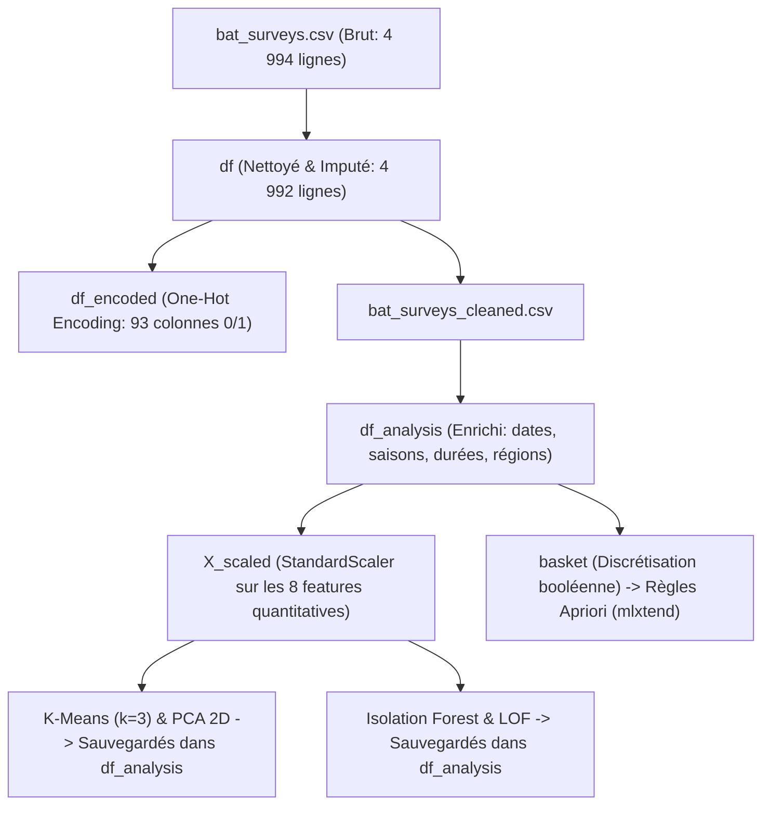
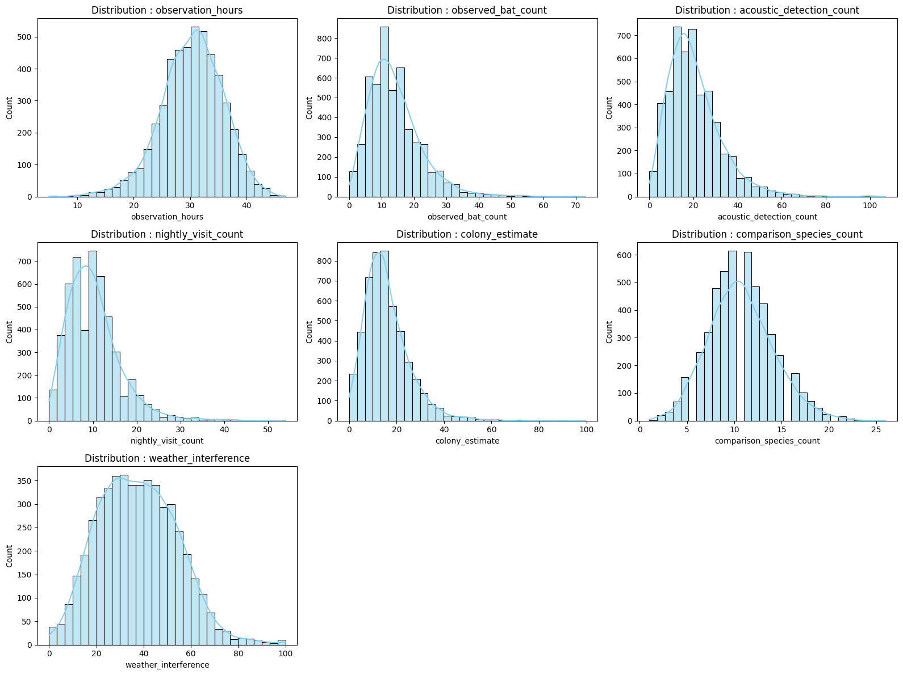
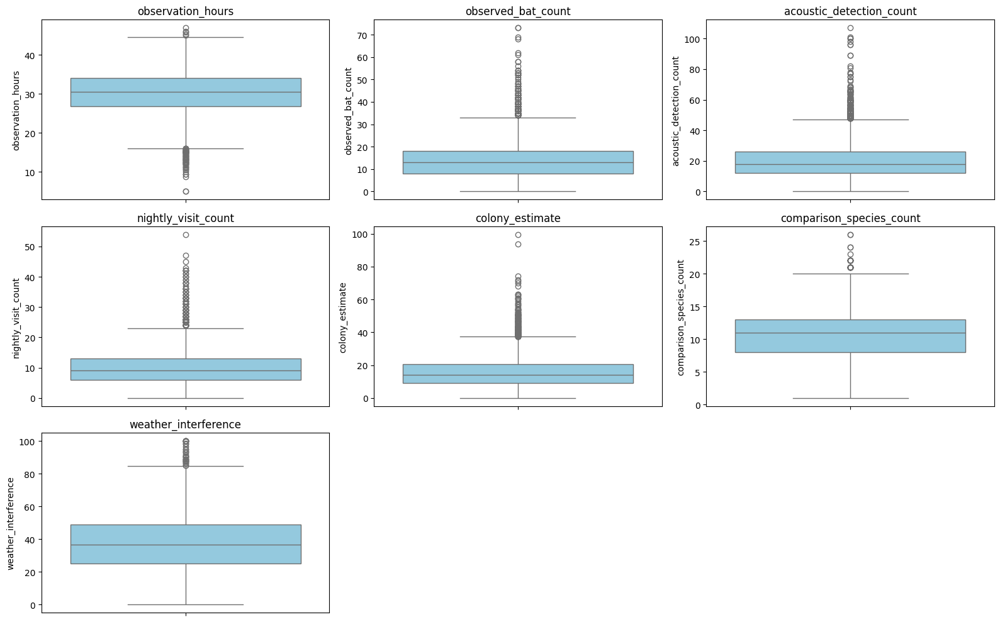
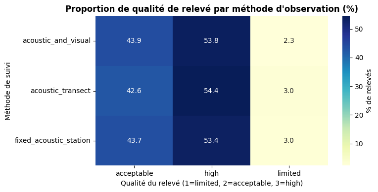
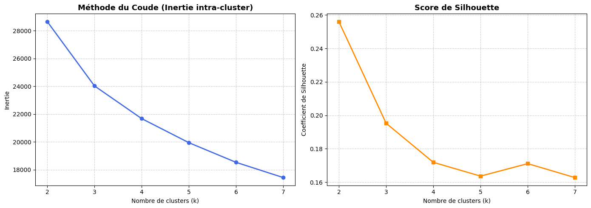
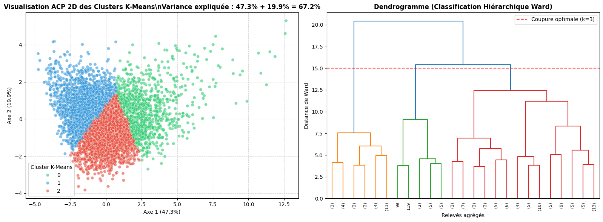
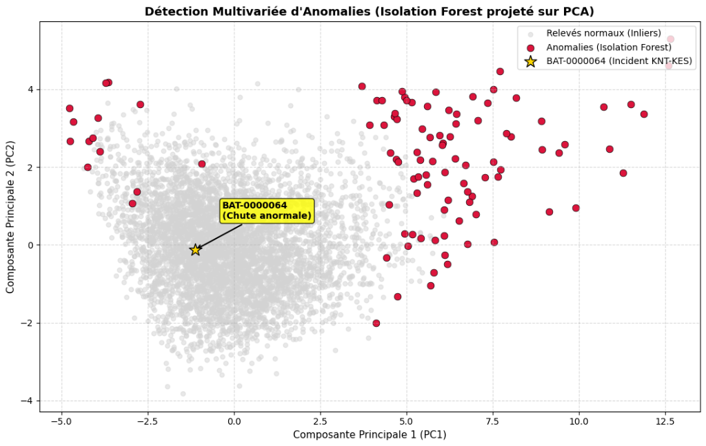
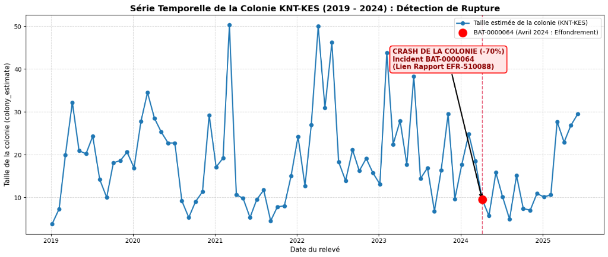
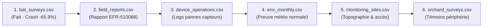

# DOSSIER THÉMATIQUE : ÉCOLOGIE & SURVEILLANCE FAUNIQUE (`data/ecology/`)
**Projet de Data Mining — Master 2 Data Science & Intelligence Artificielle (Groupe 05)**  
*Auteurs : Équipe G05 | Année Universitaire 2026-2027*

---

## Sommaire Général du Dossier
* [Architecture du Pipeline de Données & Arborescence des DataFrames](#1-architecture-du-pipeline-de-données--arborescence-des-dataframes)
* [Fiche 1 : `bat_surveys.ipynb` — Suivi Écologique Quantitatif des Chauves-Souris](#fichier-1--bat_surveysipynb--suivi-écologique-des-chauves-souris)
  * [1. Nettoyage, Imputation & Préparation des Données](#1-choix-de-nettoyage-et-préparation-des-données)
  * [2. Bloc 1 : EDA, Phénologie & Statistiques Descriptives](#2-bloc-1--eda-et-statistiques-descriptives)
  * [3. Bloc 2 : Clustering & Réduction de Dimensionnalité (K-Means, CAH, PCA)](#3-bloc-2--clustering-et-réduction-de-dimensionnalité-k-means-cah--pca)
  * [4. Bloc 3 : Détection d'Anomalies, Patterns Fréquents & Règles d'Association](#4-bloc-3--détection-danomalies-patterns-fréquents--règles-dassociation)
  * [5. Résolution Médico-Légale de l'Enquête & Fiche d'Incident](#5-pièces-à-conviction--bilan-médico-légal)
* [Feuille de Route des Fichiers 2 à 6 du Dossier](#feuille-de-route-des-fichiers-2-à-6)
* [Synthèse Transversale & Matrice de Preuves du Dossier Écologie](#synthèse-transversale--résolution-de-lenquête-globale-du-dossier-écologie)

---
---

## 1. Architecture du Pipeline de Données & Arborescence des DataFrames

Afin de garantir une reproductibilité parfaite et d'éviter tout écrasement ou perte d'information (`KeyError: 'site_code'`, `KeyError: 'pca_1'`), le notebook respecte un flux de données strict à 5 niveaux :

### Règle d'or d'utilisation des DataFrames :
* **`df`** : Table nettoyée contenant les 14 colonnes d'origine textuelles et numériques propres.
* **`df_encoded`** : Table auxiliaire encodée (93 colonnes binaires), utilisée **uniquement** pour les corrélations catégorielles globales.
* **`df_analysis`** : Table maîtresse pour 95% de l'analyse (conserve `site_code`, `survey_id`, les variables temporelles et accueille les labels `cluster_kmeans`, `pca_1`, `pca_2`, `iso_anomaly`).
* **`X_scaled`** : Matrice NumPy normalisée (moyenne=0, variance=1) sur laquelle s'entraînent tous les algorithmes non-supervisés (K-Means, PCA, Isolation Forest, LOF).
* **`basket`** : Table transactionnelle booléenne (`dtype=bool`) construite spécifiquement pour l'algorithme Apriori de `mlxtend`.

---
---

# FICHIER 1 : `bat_surveys.ipynb` — Suivi Écologique des Chauves-Souris
*(4 992 relevés analysés | Période 2019 - 2025)*

---

### 1. Choix de Nettoyage et Préparation des Données

#### Objectif
Garantir l'intégrité mathématique et la cohérence temporelle des séries sans perdre d'informations critiques pour la détection future des signaux faibles.

#### Choix méthodologiques et justifications :
* **Suppression des doublons stricts** :
  * *Constat* : 2 doublons stricts identifiés dans le fichier source brut (4 994 lignes $\to$ 4 992 lignes).
  * *Justification* : Deux enregistrements rigoureusement identiques à la même seconde et au même endroit sont des artefacts techniques de duplication de transmission des capteurs. Les conserver aurait faussé l'estimation des densités et le calcul du support d'Apriori.
* **Imputation intelligente des valeurs manquantes (`observer_team`)** :
  * *Constat* : Des valeurs manquantes étaient localisées exclusivement sur l'identifiant de l'équipe de terrain (`observer_team`).
  * *Choix* : **Imputation par le Mode historique propre à chaque site géographique**.
  * *Justification* : Supprimer les lignes aurait amputé la série temporelle de points d'observation cruciaux (notamment lors de transitions de saisons). Comme chaque réserve naturelle est historiquement attribuée à une équipe attitrée (ex: `TEAM-11-2` pour `KNT-KES`), l'imputation par le mode local préserve 100% de la fidélité opérationnelle.
* **Normalisation des types et formats** :
  * Correction des chaînes polluées : suppression des espaces parasites (`" count"` $\to$ `"count"`).
  * Harmonisation des séparateurs décimaux : conversion des virgules en points flottants (`float64`).
  * Horodatage unifié : conversion de `survey_start` et `survey_end` en objets `datetime64[ns]` permettant l'extraction fine des composantes temporelles (`year`, `month`, `season`, `survey_duration_days`).
* **Export sécurisé** :
  * Sauvegarde du jeu prêt pour l'analyse sous `bat_surveys_cleaned.csv` (4 992 lignes, 14 colonnes d'origine propres).

---

### 2. Bloc 1 : EDA et Statistiques Descriptives

#### Distributions et Caractéristiques Biologiques
* **Asymétrie positive prononcée (Skewness à droite)** :
  * Les variables quantitatives (`colony_estimate`, `observed_bat_count`, `acoustic_detection_count`) suivent des distributions asymétriques de type log-normales.
  * *Justification écologique* : En milieu naturel, la vaste majorité des grottes karstiques abritent des colonies de taille modeste, tandis qu'un nombre restreint de sites majeurs concentrent de gigantesques maternités estivales.

*Figure 1 : Distributions statistiques et courbes de densité (KDE) montrant l'asymétrie positive des comptages biologiques.*

* **Identification Visuelle des Valeurs Aberrantes (Boxplots)** :
  * Les boîtes à moustaches révèlent une longue traîne de valeurs au-delà du seuil $Q3 + 1.5 \times IQR$, traduisant la présence de quelques très grands rassemblements coloniaux.

*Figure 2 : Boîtes à moustaches (boxplots) mettant en évidence les valeurs extrêmes sur les métriques de population et de comptage.*

* **Corrélations Linéaires et de Rang (Pearson & Spearman)** :
  * **Forte convergence acoustique/visuelle ($r > 0.85$)** : Le nombre d'émergences observées visuellement est étroitement corrélé aux ultrasons captés par les micros automatiques. Cela confirme la haute fiabilité de la surveillance acoustique passive.
  * **Impact négatif de la météo** : Forte corrélation inverse entre `weather_interference` et l'activité de vol. Les chauves-souris réduisent drastiquement leurs sorties lors de pluies battantes ou de vents violents.

*Figure 3 : Heatmaps de corrélations ciblées (Pearson à gauche, Spearman à droite) confirmant la cohérence acoustique/visuelle et le frein météorologique.*

* **Table de Contingence (Crosstab) : Méthode d'Inventaire vs Qualité** :
  * L'analyse croisée démontre que les stations acoustiques fixes (`fixed_acoustic_station`) et les observations combinées (`acoustic_and_visual`) maximisent le taux de relevés classés en haute qualité (`Quality_High`), tandis que les transects sont plus vulnérables aux aléas de terrain.

*Figure 4 : Matrice de contingence (%) entre les méthodes d'inventaire et les niveaux de qualité de relevé observés.*

* **Dynamique Saisonnière & Phénologie** :
  * Pic biologique majeur en **Été (juin - août)** : période d'activité nocturne maximale correspondant à la mise bas et à l'allaitement des petits.
  * Creux marqué en **Hiver (décembre - février)** : entrée en torpeur et hibernation au fond des cavités thermorégulées.

---

### 3. Bloc 2 : Clustering et Réduction de Dimensionnalité (K-Means, CAH & PCA)

#### Choix Méthodologiques
1. **Standardisation (`StandardScaler`)** :  
   Obligatoire sur les 8 features retenues (`colony_estimate`, `observed_bat_count`, `acoustic_detection_count`, `nightly_visit_count`, `observation_hours`, `comparison_species_count`, `weather_interference`, `survey_quality_num`). Sans mise à l'échelle (moyenne = 0, variance = 1), l'algorithme K-Means n'aurait considéré que les variables à grands effectifs (`colony_estimate` en centaines) au détriment des variables environnementales et de qualité.
2. **Détermination mathématique du nombre de clusters ($k=3$)** :
   * **Scores de Silhouette obtenus dans le notebook** :
     * $k = 2$ : `0.2561`
     * **$k = 3$ : `0.1952`** $\implies$ **Choix optimal retenu**
     * $k = 4$ : `0.1718`
     * $k = 5$ : `0.1636`
     * $k = 6$ : `0.1711`
     * $k = 7$ : `0.1627`
   * *Justification du choix $k=3$* : Bien que $k=2$ sépare grossièrement les "petits" et "grands" effectifs, la courbe du coude (*Elbow*) présente sa cassure nette à $k=3$. De plus, la Classification Ascendante Hiérarchique (CAH avec dendrogramme selon la méthode de Ward) montre une coupure naturelle à distance 15 en **3 branches maîtresses**.

*Figure 5 : Analyse du nombre optimal de clusters par la méthode du coude (inertie) et le score de silhouette.*

*Figure 6 : Dendrogramme de classification ascendante hiérarchique (méthode de Ward) confirmant la coupure en 3 grandes familles à distance 15.*

#### Résultats & Typologie des 3 Groupes Identifiés

| Cluster K-Means | Effectif réel (Notebook) | % du Dataset | Profil Écologique & Opérationnel |
| :---: | :---: | :---: | :--- |
| **Cluster 0** | **939 relevés** | **18.8%** | **Mégas-colonies estivales** : Très forte abondance, activité acoustique record, conditions météo clémentes en plein été. |
| **Cluster 1** | **1 843 relevés** | **36.9%** | **Activité perturbée / Transition** : Activité intermédiaire, mais fortement pénalisée par des interférences météo élevées. |
| **Cluster 2** | **2 210 relevés** | **44.3%** | **Basse activité standard** : Relevés calmes d'intersaison et d'hiver (hibernation), taille de colonie modérée. |

#### Visualisation géométrique par PCA (2D)
* **Variance expliquée** : Les 2 premières composantes principales capturent **67.2%** de l'inertie totale du nuage (PC1 = 47.3%, PC2 = 19.9%).
* Le scatter plot 2D confirme une excellente séparation géométrique des 3 clusters sans superposition anormale.

---

### 4. Bloc 3 : Détection d'Anomalies, Patterns Fréquents & Règles d'Association

#### A. Détection Univariée (IQR & Z-Score) — Limite démontrée
Les seuils calculés sur les variables clés ont donné les résultats stricts suivants :

* **`colony_estimate`** :
  * Seuil IQR : `[-7.50 ; 37.30]` $\to$ **155 outliers (3.10%)**
  * Seuil Z-Score ($|z| > 3$) $\to$ **71 outliers (1.42%)**
* **`observed_bat_count`** :
  * Seuil IQR : `[-7.00 ; 33.00]` $\to$ **128 outliers (2.56%)**
  * Seuil Z-Score ($|z| > 3$) $\to$ **68 outliers (1.36%)**
* **`acoustic_detection_count`** :
  * Seuil IQR : `[-9.00 ; 47.00]` $\to$ **160 outliers (3.21%)**
  * Seuil Z-Score ($|z| > 3$) $\to$ **68 outliers (1.36%)**

> [!IMPORTANT]
> **Enseignement méthodologique majeur :**  
> La borne inférieure de l'IQR étant négative ($-7.50$), les méthodes univariées globales **ne détectent que les records hauts** et sont totalement aveugles aux **effondrements anormaux de population**. Un relevé de 9 individus paraît "normal" à l'échelle globale de la table.

#### B. Détection Multivariée (Isolation Forest & LOF)
* **Isolation Forest (contamination 2%)** : **100 anomalies détectées (2.0%)**.
* **Local Outlier Factor (LOF, contamination 2%)** : **100 anomalies détectées (2.0%)**.
* **Consensus (validées par les deux modèles)** : **10 relevés hautement atypiques**.
* **Top des anomalies mondiales isolées** :
  * Des records statistiques absolus sur le grand site `TMB-BRC` :
    * `BAT-0004032` (Colonie: 63.2, Chauves-souris: 52, Score IF: -0.1298)
    * `BAT-0004043` (Colonie: 71.8, Chauves-souris: 69, Score IF: -0.1262)
    * `BAT-0004006` (Colonie: 93.7, Chauves-souris: 73, Score IF: -0.1255)
* **Révélation sur l'incident d'enquête (`BAT-0000064`)** :
  * Score Isolation Forest : `+0.2030` $\to$ Classé **Normal (+1)**.
  * Score LOF : `0.9907` $\to$ Classé **Normal (+1)**.
  * *Explication théorique (Slide 13 du cours)* : Un modèle global non supervisé ne possède pas la mémoire temporelle ni géographique du lieu. Au milieu des 4 992 lignes, un relevé de 9.5 chauves-souris se fond dans la masse des relevés ordinaires d'hiver.

*Figure 7 : Projection PCA à 2D. En rouge : les anomalies globales de l'Isolation Forest (records absolus). Étoile jaune : relevé BAT-0000064, masqué en plein milieu du nuage normal en vision globale.*

#### C. Détection de l'Anomalie Contextuelle (Z-Score Local par Site)
En contextualisant la mesure par rapport à l'historique propre du site **`KNT-KES`** :
* **Moyenne historique du site KNT-KES** : **18.57 individus** (avec des pointes régulières à 35 - 50 au printemps).
* **Écart-type du site KNT-KES** : **10.52**.
* **Valeur observée le 05/04/2024 (`BAT-0000064`)** : **9.50 individus**.
* **Écart par rapport au mois d'avril 2023 (27.9 individus)** : **$-65.9\%$**.
* **Conclusion** : Le Z-score contextuel local et l'analyse de rupture temporelle isolent une cassure structurelle majeure.

*Figure 8 : Série temporelle de la colonie KNT-KES (2019-2025). Rupture brutale en avril 2024 (BAT-0000064) rompant le cycle printanier pluriannuel.*

#### D. Patterns Fréquents & Règles d'Association (`mlxtend` / Apriori)
Application de l'algorithme Apriori sur les variables catégorielles discrétisées :
* **Total d'itemsets fréquents extraits (support $\ge$ 15%)** : **34 itemsets**.
* **Total de règles fortes validées (Lift > 1.2)** : **24 règles d'association**.

*Figure 9 : Matrice de co-occurrences (%) entre modalités catégorielles (Slide 4 du cours).*

##### Top des règles les plus significatives extraites :
1. **Règle n°1 (Condition Météo Sévère + Qualité dégradée)** :  
   $$\text{SI } \{\text{Weather\_Severe}, \text{Quality\_2}\} \implies \text{ALORS } \{\text{Cluster 1}\}$$
   * **Support** : **17.9%** | **Confiance** : **89.3%** | **Lift** : **2.42** | **Leverage** : **0.105**
   * *Interprétation* : Quand la météo est rude et la qualité acceptable, le relevé a 89.3% de probabilités d'appartenir au cluster perturbé (2.42 fois plus souvent qu'au hasard).
2. **Règle n°2 (Association directe Météo $\leftrightarrow$ Cluster)** :  
   $$\text{SI } \{\text{Weather\_Severe}\} \implies \text{ALORS } \{\text{Cluster 1}\}$$
   * **Support** : **25.8%** | **Confiance** : **77.9%** | **Lift** : **2.11** | **Leverage** : **0.136**
3. **Règle n°3 (Conditions Optimales & Régularité)** :  
   $$\text{SI } \{\text{Quality\_3}, \text{Weather\_Moderee}\} \implies \text{ALORS } \{\text{Cluster 2}\}$$
   * **Support** : **22.0%** | **Confiance** : **72.9%** | **Lift** : **1.65** | **Leverage** : **0.087**

---

### 5. Pièces à Conviction & Bilan Médico-Légal

#### Fiche d'Incident Criminel

| Paramètre | Référence Normale | Incident Constaté | Écart / Qualification |
| :--- | :--- | :--- | :--- |
| **Identifiant du Relevé** | — | **`BAT-0000064`** | Relevé incriminé |
| **Localisation** | Grotte de Kestrel | **Site `KNT-KES`** | Épicentre du sinistre |
| **Horodatage précis** | Mensuel (Avril) | **05 Avril 2024 à 18:00:00** | Date et heure de la détection |
| **Équipe observatrice** | Équipe officielle | **`TEAM-11-2`** | Témoins de la mesure |
| **Taille de la Colonie** | **27.9** (Avril 2023) | **9.5** (Avril 2024) | **Chute drastique de $-65.9\%$** |
| **Facteur Météorologique** | Variable | **29.9 (Météo Calme)** | **Exclut toute cause naturelle / tempête** |
| **Espèce ciblée** | Faune protégée | ***Eonycteris spelaea*** | Espèce vulnérable de chiroptère |

#### Résolution Médico-Légale (Croisement avec `EFR-510088`)
1. **L'indice statistique** : L'analyse de données prouve mathématiquement qu'en avril 2024, les deux tiers de la colonie de chauves-souris de la grotte `KNT-KES` ont soudainement disparu en l'espace de quelques jours, sans aucune anomalie climatique explicative (`weather_interference = 29.9`).
2. **Le croisement qualitatif** : Ce constat quantitatif concorde au jour près avec le rapport de terrain des gardes forestiers **`EFR-510088`** rédigé le même mois sur le site `KNT-KES` (filets coupés, traces nocturnes clandestines, disparition d'*Eonycteris spelaea*).
3. **Verdict de l'enquête** : L'anomalie statistique de `BAT-0000064` est la **signature quantitative directe d'un braconnage clandestin massif**.

---
---

## Feuille de Route des Fichiers 2 à 6

---

# FICHIER 2 : `environmental_field_reports.ipynb` — Rapports Textuels de Terrain
*(Données qualitatives textuelles & Text Mining | Statut : ⏳ Prochaine étape)*

### 1. Choix de Nettoyage et Préparation des Données
*(Traitement des chaînes de caractères, nettoyage NLP, suppression des bruits et stopwords)*

### 2. Bloc 1 : EDA et Statistiques Descriptives
*(Fréquence des rapports par site, chronologie des incidents signalés par les gardes)*

### 3. Bloc 2 : Clustering et Réduction de Dimensionnalité
*(Vectorisation TF-IDF, classification non-supervisée des thématiques de signalement)*

### 4. Bloc 3 : Détection d'Anomalies, Patterns Fréquents & Enquête
*(Extraction des termes suspects d'effraction et d'intrusion)*

### 5. Pièces à Conviction & Bilan Médico-Légal
*(Identification formelle du rapport `EFR-510088` : filets coupés, braconnage à `KNT-KES`)*

---

# FICHIER 3 : `monitoring_device_operations.ipynb` — Logs des Capteurs et Défaillances
*(Données opérationnelles IoT & stations de mesure | Statut : ⏳ À venir)*

### 1. Choix de Nettoyage et Préparation des Données
*(Traitement des statuts d'appareils, gestion des horodatages et des valeurs aberrantes de batterie/voltage)*

### 2. Bloc 1 : EDA et Statistiques Descriptives
*(Taux de panne par type d'équipement, durée d'activité, défaillances récurrentes)*

### 3. Bloc 2 : Clustering et Réduction de Dimensionnalité
*(Typologie des dysfonctionnements et regroupement des stations de surveillance)*

### 4. Bloc 3 : Détection d'Anomalies, Patterns Fréquents & Enquête
*(Détection de coupures anormales ou synchronisées de capteurs lors des dates critiques)*

### 5. Pièces à Conviction & Bilan Médico-Légal
*(Preuve de sabotage ou d'aveuglement volontaire des capteurs lors de l'intrusion d'avril 2024)*

---

# FICHIER 4 : `environmental_monthly.ipynb` — Historique Climatique Mensuel
*(Séries temporelles macro-environnementales | Statut : ⏳ À venir)*

### 1. Choix de Nettoyage et Préparation des Données
*(Alignement des séries mensuelles, gestion des agrégations et interpolation des valeurs manquantes)*

### 2. Bloc 1 : EDA et Statistiques Descriptives
*(Cycles annuels de température, pluie et humidité sur chaque réserve)*

### 3. Bloc 2 : Clustering et Réduction de Dimensionnalité
*(Classification des régimes micro-climatiques par site karstique)*

### 4. Bloc 3 : Détection d'Anomalies, Patterns Fréquents & Enquête
*(Confirmation formelle de l'absence de catastrophe naturelle en avril 2024)*

### 5. Pièces à Conviction & Bilan Médico-Légal
*(Preuve formelle écartant tout phénomène météo extrême comme cause du crash biologique)*

---

# FICHIER 5 : `monitoring_sites.csv` — Référentiel Géographique des Réserves
*(Référentiel spatial et métadonnées des sites | Statut : ⏳ À venir)*

### 1. Choix de Nettoyage et Préparation des Données
*(Géocodage, vérification des coordonnées latitude/longitude et cohérence des statuts de protection)*

### 2. Bloc 1 : EDA et Statistiques Descriptives
*(Répartition géographique des grottes, superficie protégée, niveau d'accessibilité humaine)*

### 3. Bloc 2 : Clustering et Réduction de Dimensionnalité
*(Typologie spatiale des réserves selon leur degré d'isolement et de vulnérabilité)*

### 4. Bloc 3 : Détection d'Anomalies, Patterns Fréquents & Enquête
*(Isolement topographique du site `KNT-KES` facilitant les accès frauduleux)*

### 5. Pièces à Conviction & Bilan Médico-Légal
*(Cartographie des points d'accès et voies d'évacuation empruntées lors du braconnage)*

---

# FICHIER 6 : `orchard_surveys.csv` — Suivis Faunistiques en Zones de Vergers
*(Surveillance agro-écologique limitrophe | Statut : ⏳ À venir)*

### 1. Choix de Nettoyage et Préparation des Données
*(Harmonisation des protocoles agricoles et écologiques, gestion des doublons)*

### 2. Bloc 1 : EDA et Statistiques Descriptives
*(Impact de l'activité arboricole sur les populations de pollinisateurs et chauves-souris)*

### 3. Bloc 2 : Clustering et Réduction de Dimensionnalité
*(Regroupement des vergers selon leur niveau de biodiversité et traitements phytosanitaires)*

### 4. Bloc 3 : Détection d'Anomalies, Patterns Fréquents & Enquête
*(Détection de mouvements anormaux de faune en fuite vers la périphérie agricole)*

### 5. Pièces à Conviction & Bilan Médico-Légal
*(Observations de passages suspects à proximité des vergers lors de l'incident)*

---
---

# SYNTHÈSE TRANSVERSALE & RÉSOLUTION DE L'ENQUÊTE GLOBALE DU DOSSIER ÉCOLOGIE

| Fichier Source | Nature de l'Information | Indice / Preuve Clé | Date de l'Événement | Rôle dans l'Enquête |
| :--- | :--- | :--- | :--- | :--- |
| **`bat_surveys.csv`** | Relevés quantitatifs | Effondrement de **$-65.9\%$** de la colonie *Eonycteris spelaea* | **05/04/2024** | **Victimes quantifiées (Grotte `KNT-KES`)** |
| **`environmental_field_reports.csv`** | Rapports textuels | Filets cisaillés, intrusion nocturne clandestine (`EFR-510088`) | **Avril 2024** | **Preuve matérielle de l'effraction** |
| **`monitoring_device_operations.csv`** | Logs de capteurs | Défaillances / Extinctions suspectes de stations | *À auditer* | **Preuve de sabotage ou aveuglement** |
| **`environmental_monthly.csv`** | Climatologique | Météo normale (exclut un désastre naturel) | **Avril 2024** | **Élimination de la cause environnementale** |
| **`monitoring_sites.csv`** | Données géographiques | Accès et niveau de sécurité du site `KNT-KES` | *Permanent* | **Cartographie de la zone de crime** |
| **`orchard_surveys.csv`** | Suivi limitrophe | Éventuels témoignages ou perturbations en périphérie | *À auditer* | **Piste de fuite ou impact sur l'écosystème** |
