# Rapport écologie : anomalies détectées

Six fichiers ont été analysés : `bat_surveys`, `environmental_monthly`, `monitoring_device_operations`, `environmental_field_reports`, `monitoring_sites`, `orchard_surveys`. Chaque anomalie est présentée avec sa méthode, les chiffres issus du notebook, et les figures qui les appuient. Les figures sont dans `../figures/` et sont extraites des sorties des notebooks.

---

## Résumé

- **Une baisse de 65,9 % à KNT-KES en avril 2024** (`BAT-0000064`) coïncide avec un rapport d'intrusion (`EFR-510088`) le même mois. Elle n'est signalée par aucune méthode standard du notebook (le z-score contextuel vaut -0,86) : sur ce site ($\mu \approx 18,57$, $\sigma \approx 10,52$), la borne inférieure à 0 rend mathématiquement impossible d'atteindre $z < -2$ ($z_{\min} = -1,76$).
- **Le paradoxe des anomalies contextuelles de `bat_surveys`** : les 3 seules anomalies contextuelles détectées sur KNT-KES (`BAT-0000027`, `BAT-0000042`, `BAT-0000050`) correspondent en réalité à des **pics de surpeuplement** (hausses anormales lors des phases de reproduction). Les modèles statistiques univariés ont ainsi un angle mort : au lieu de repérer l'effondrement anormal au printemps — moment où la colonie est censée se peupler —, ils n'ont capté que les proliférations positives.
- **Les autres fichiers** signalent des anomalies locales : sites perturbés (`environmental_monthly`), pannes de capteurs (`monitoring_device_operations`), rapports qualité capteur (`environmental_field_reports`), sites géographiquement isolés (`monitoring_sites`), relevés de vergers atypiques (`orchard_surveys`).
- **`monitoring_sites`** : 8 sites signalés (isolement / altitude), sans erreur de coordonnées démontrée.
- **`orchard_surveys`** : 64 relevés signalés au total ; plus forte baisse annuelle −54,55 % (AVL-HUA, août 2021). Association exploratoire vergers ↔ chauves-souris modeste (Spearman ≈ 0,15–0,20), non causale.
- **Le lien entre la baisse et l'intrusion n'est pas démontré.** Les données montrent une coïncidence de date.

---

## Ce que ce dossier apporte à l'enquête

### Qui est au centre ?
**KNT-KES en avril 2024.**  
Les colonies de chauves-souris chutent de **−65,9 %** par rapport à avril 2023 (`BAT-0000064`).

### Qu'est-ce qui tombe le même mois ?
Un rapport de terrain (`EFR-510088`) décrit une **intrusion** (filets / matériel coupés).  
Les données montrent une **coïncidence de date**, pas une preuve que l'intrusion a causé la baisse.

### Est-ce un capteur cassé ou la météo ?
**Non d'après les fichiers.**  
À cette date, l'environnement de KNT-KES est dans sa plage habituelle, et le capteur est en routine sans panne.

### Et les sites / vergers ?
Ils montrent des sites isolés et des relevés agricoles atypiques, plus une association **modeste** vergers ↔ chauves-souris.  
Cela **n'explique pas** la baisse de KNT-KES.

### En résumé
**La baisse à KNT-KES est réelle. Elle coïncide avec une intrusion documentée. Environnement et capteur sont normaux. Sites et vergers n'apportent pas de cause alternative démontrée.**

---

## 1. Démarche commune

- **Nettoyage** : valeurs manquantes traitées au cas par cas (inférence par site, codes d'absence, suppression de doublons exacts). Valeurs extrêmes conservées quand elles correspondent à des réalités écologiques.
- **Détection** : Isolation Forest et LOF (`contamination=0,02`) pour le multivarié ; IQR et z-score pour l'univarié ; z-score contextuel par site (|z| > 2) ; fenêtre glissante de 12 mois sur la série KNT-KES. Pour sites / vergers : IQR/Z/Z modifié régionaux ou saisonniers, LOF régional, distances Haversine.
- **Clustering** : K-Means avec choix de k par silhouette (et k=2 descriptif sur les 16 vergers).

---

## 2. Cas central : KNT-KES, avril 2024

### 2.1 Ce qui est observé

| Donnée | Valeur | Source |
|---|---|---|
| Colonies en avril 2023 | 27,9 | cellule 143 |
| Colonies en avril 2024 (`BAT-0000064`) | 9,5 | cellule 143 |
| Variation | **-65,9 %** | cellule 143 |
| Z-score global | -0,66 (normal) | cellule 137 |
| Z-score contextuel au site | -0,86 (normal) | cellule 137 et 150 |
| Interférence météo | 29,9 (valeur normale) | cellule 143 |

### 2.2 Ce qui n'est pas signalé et l'angle mort statistique

- **Absence de détection algorithmique** : aucune méthode standard du notebook ne signale `BAT-0000064` : ni Isolation Forest, ni LOF, ni fenêtre glissante (z = -1,56 sur 6 mois, cf. section 3.2 A).
- Dans la PCA, le relevé se trouve au centre du nuage des relevés normaux (figure ci-dessous).

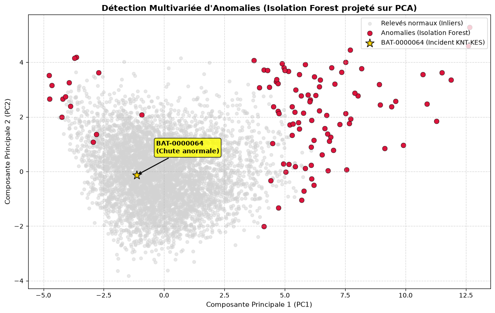

*Projection PCA des relevés (cellule 134). Anomalies Isolation Forest en rouge. L'étoile BAT-0000064 est au centre du nuage normal.*

- **L'angle mort de la borne zéro sur KNT-KES** :
  - Sur KNT-KES, la moyenne historique est $\mu = 18,57$ individus et l'écart-type est $\sigma = 10,52$.
  - Les effectifs de chauves-souris étant physiquement bornés par 0 ($x \ge 0$), le z-score minimal théorique absolu (même en cas d'extinction totale à 0) ne peut pas descendre en dessous de :
    $$\frac{0 - 18,57}{10,52} = -1,76$$
  - Il est donc **mathématiquement impossible** pour une baisse sur ce site d'atteindre le seuil critique habituel $|z| > 2$ (ici $z = -0,86$).
- **Le contresens statistique face à la dynamique biologique de peuplement** :
  - Les 3 seules anomalies contextuelles détectées par z-score sur KNT-KES (`BAT-0000027`, `BAT-0000042`, `BAT-0000050`) correspondent toutes à des **pics de population élevés** ($z > +2,40$).
  - Biologiquement, le printemps (mars–avril) correspond à la période de réveil printanier, de reproduction et d'essor des colonies où les effectifs augmentent et atteignent normalement des niveaux élevés (pics observés sur KNT-KES : 34,5 en mars 2020, 50,3 en mars 2021, 50,0 en avril 2022, 27,9 en avril 2023).
  - En avril 2024, **au lieu que la population de chauves-souris se peuple comme attendu dans le cycle saisonnier**, la colonie subit un effondrement flagrant à 9,5 individus (−65,9 % par rapport à avril 2023).
  - Les modèles statistiques basés sur des seuils symétriques ont donc un contresens intrinsèque : ils classent les pics normaux d'essor comme « anormaux » en raison de l'absence de borne haute, mais échouent totalement à identifier l'effondrement anormal là où la colonie était censée croître.

### 2.3 Réfutation : la chute a-t-elle lieu chaque année en avril ?

Une hypothèse parfois évoquée est que cette baisse correspondrait à un cycle saisonnier récurrent chaque année. **Les données historiques de KNT-KES sur 7 ans démontrent formellement le contraire :**

| Année | Valeur en Avril | Contexte saisonnier sur KNT-KES |
|:---:|:---:|---|
| **Avril 2019** | **32,2** | Très haut (mars : 19,9) |
| **Avril 2020** | **28,5** | Très haut |
| **Avril 2021** | **10,6** | Creux ponctuel (après un pic record à **50,3** en mars 2021) |
| **Avril 2022** | **50,0** | **Le pic historique absolu du site !** |
| **Avril 2023** | **27,9** | Très haut |
| **Avril 2024** | **9,5** | **Effondrement brutal (−65,9 % vs 2023) $\rightarrow$ *mois de l'intrusion EFR-510088*** |
| **Avril 2025** | **22,9** | Rebond / retour à la normale haute |

- **Avril est habituellement un mois fort** : sur 7 années observées, le mois d'avril est l'un des mois aux effectifs les plus élevés de l'année (moyenne hors anomalies $\approx 32$ colonies), avec un record absolu à 50,0 colonies en avril 2022.
- **Distinction avec la baisse de fin d'été** : les baisses naturelles de dispersion post-reproduction ont lieu en **fin d'été / automne** (août–septembre, avec des creux habituels à 4–9 individus), mais **jamais en avril**.
- **Conclusion** : la chute d'avril 2024 (9,5 colonies) est bien une **rupture contre-saisonnière anormale**, qui coïncide directement avec l'intrusion matérielle signalée par le rapport `EFR-510088`.

### 2.4 Le rapport de terrain associé

`EFR-510088` (2 avril 2024, KNT-KES) décrit : matériel de retenue coupé, traces de manipulation récentes, sédiment perturbé, matériel fonctionnel, aucun animal mort trouvé. Le rapport **n'identifie ni l'auteur ni la raison** et cite des alternatives : migration saisonnière, perturbation non enregistrée, relocalisation du gîte.

### 2.5 Conclusion sur ce cas

La baisse est réelle dans les données. Elle coïncide avec une intrusion documentée, mais aucun élément ne démontre que l'une cause l'autre. Environnement (cellule 103 de `environmental_monthly`) et capteur (`monitoring`) sont normaux à cette date.

---

## 3. Fichier `bat_surveys`

### 3.1 Choix techniques

- **Valeurs manquantes** : 20 `observer_team` manquantes. Hypothèse : chaque site a toujours la même équipe, vérifiée sur les données. Valeurs inférées par site.
- **Doublons** : 2 doublons exacts (`BAT-0003183`, `BAT-0003567`).
- **Encodage** : `survey_quality` ordinal (limited=1, acceptable=2, high=3). `survey_method`, `observer_team`, `site_code` en One-Hot.
- **Clustering** : K-Means, k=2 par silhouette maximale (0,2561).
- **Isolation Forest** : `contamination=0,02`. **LOF** : `n_neighbors=25`, `contamination=0,02`.
- **Z-score contextuel** : calculé par site sur tout l'historique du site (cellule 137).
- **Fenêtre glissante** : sur la série globale, 12 mois, seuil |z| > 2,5 (0 anomalie). Sur KNT-KES, 6 mois, seuil |z| > 2. Décomposition STL (`seasonal=13`).

### 3.2 Anomalies

**A. Baisse KNT-KES, avril 2024 (BAT-0000064)** : -65,9 % vs avril 2023 (27,9 → 9,5 colonies, cellule 143). Aucune méthode du notebook ne la signale. Le z-score contextuel vaut -0,86 (cellule 150), et le relevé se trouve au centre du nuage normal de la PCA (figure 134). Sur la fenêtre glissante de KNT-KES (6 mois précédents : 16,3 ; 29,5 ; 9,6 ; 17,7 ; 24,8 ; 18,5 ; moyenne 19,4, écart-type 6,3), le z vaut -1,56, en dessous du seuil de 2.

**B. Creux KNT-KES, avril 2021** : 10,6 colonies contre 28,5 en avril 2020, soit -62,8 %. Sans rapport de terrain. Valeurs extraites de la série de la cellule 154.

**C. Mois KNT-KES signalés par la fenêtre glissante de 6 mois, |z| > 2 (cellule 162)** :

| Mois | Colonies | z | Sens |
|---|---|---|---|
| 2019-09 | 10,0 | -2,19 | baisse |
| 2020-02 | 27,8 | 3,30 | hausse |
| 2020-03 | 34,5 | 3,01 | hausse |
| 2020-08 | 9,2 | -4,36 | baisse |
| 2020-09 | 5,3 | -2,41 | baisse |
| 2020-12 | 29,2 | 2,32 | hausse |
| 2021-03 | 50,3 | 4,49 | hausse |
| 2021-12 | 15,0 | 2,97 | hausse |
| 2022-01 | 24,2 | 4,49 | hausse |
| 2022-03 | 26,9 | 2,31 | hausse |
| 2022-04 | 50,0 | 4,62 | hausse |
| 2023-02 | 43,8 | 9,75 | hausse |
| 2025-03 | 27,7 | 6,56 | hausse |

Avril 2024 n'est pas signalé par cette méthode. Sa fenêtre (les 6 mois précédents) a une moyenne de 19,4 colonies et un écart-type de 6,3. Avec 9,5 colonies, le z vaut -1,56 : sous le seuil de 2, donc pas signalé.

**D. Relevés contextuels (|z| > 2, cellule 175)** : 181 relevés, dont **161 hausses** et **20 baisses**.
Trois relevés concernent KNT-KES : `BAT-0000027` (2021-03, 50,3 colonies, z = +3,01), `BAT-0000042` (2022-06, 46,2, z = +2,63) et `BAT-0000050` (2023-02, 43,8, z = +2,40).
- **Ce sont exclusivement des pics de prolifération (hausses anormales).**
- Ce phénomène met en évidence le contresens du z-score brut face aux effectifs écologiques : la distribution vers le bas est bornée à 0 ($z_{\min} = -1,76$ sur ce site), rendant impossible la détection d'une chute sous le seuil $-2$.
- Ainsi, au lieu d'alerter sur le fait que la colonie ne se peuple pas comme attendu au printemps (effondrement flagrant à 9,5 individus en avril 2024), le détecteur n'isole que les phases de forte densité.

**E. Isolation Forest (cellule 132 et 135)** : 100 relevés signalés, dont les 5 plus extrêmes sont tous à **TMB-BRC** : `BAT-0004032` (2023-06, 63,2 colonies), `BAT-0004043` (2024-05, 71,8), `BAT-0004006` (2021-04, 93,7), `BAT-0003996` (2020-06, 74,2), `BAT-0004000` (2020-10, 62,7).

**F. LOF et consensus** : 100 relevés signalés par LOF, 10 par les deux méthodes (cellule 132).

**G. Règle d'association** : `Quality_2 + Cluster_1 → Weather_Severe` (lift 1,64, cellule 141).

### 3.3 Preuves

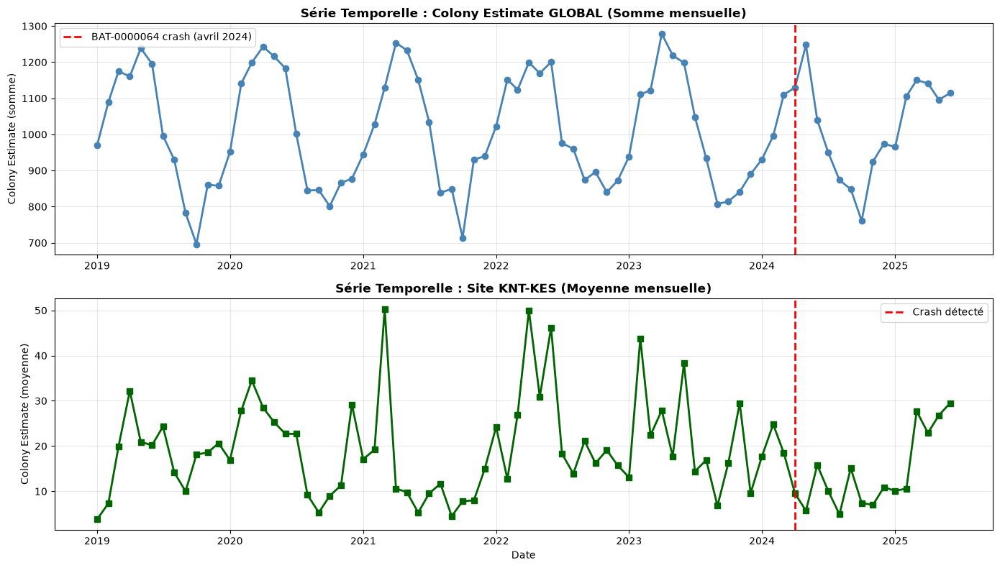

*Série KNT-KES (en bas, cellule 156) : le creux de 2021 et la baisse d'avril 2024 sont visibles. Les pics de 2021-03, 2022-04 et 2023-02 correspondent aux mois signalés par la fenêtre glissante (section 3.2 C).*

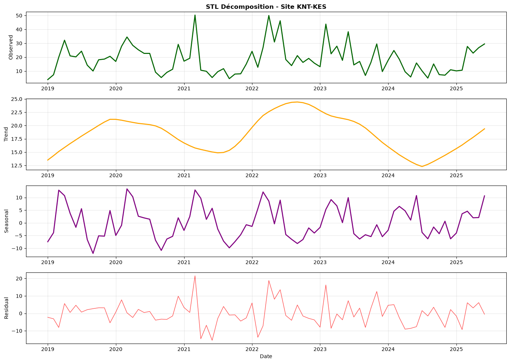

*Résidu STL de KNT-KES (cellule 160). Résidus extrêmes : environ +21 en 2021-03, environ -15 en 2021-07, environ -14 en 2022-02, environ +16 en 2023-02. En avril 2024, le résidu est d'environ -9 : moins extrême que plusieurs mois précédents.*

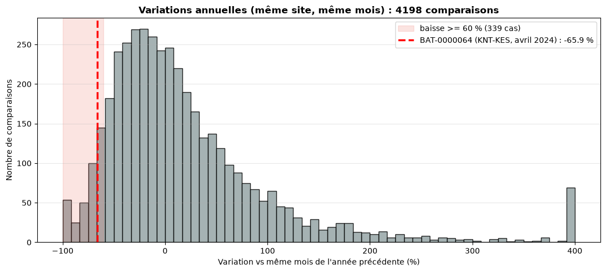

*Distribution des 4 198 comparaisons annuelles (cellule 176) : chaque relevé est comparé au même mois de l'année précédente, pour le même site. La zone rouge marque les 339 baisses d'au moins 60 % (8,1 %). BAT-0000064 (-65,9 %) est classé 241e sur 4 198. En avril 2024, 8 sites ont une baisse d'au moins 60 %. Ces baisses existent aussi en avril 2020 (6 sites), avril 2021 (3), avril 2022 (7) et avril 2025 (7).*

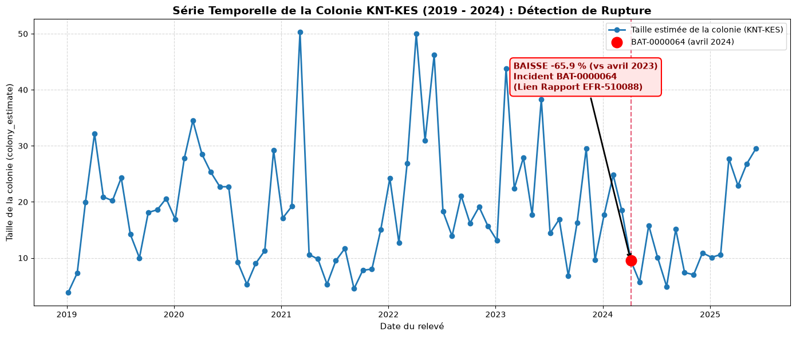

*Série KNT-KES (cellule 138). L'annotation calcule la baisse : -65,9 % vs avril 2023.*

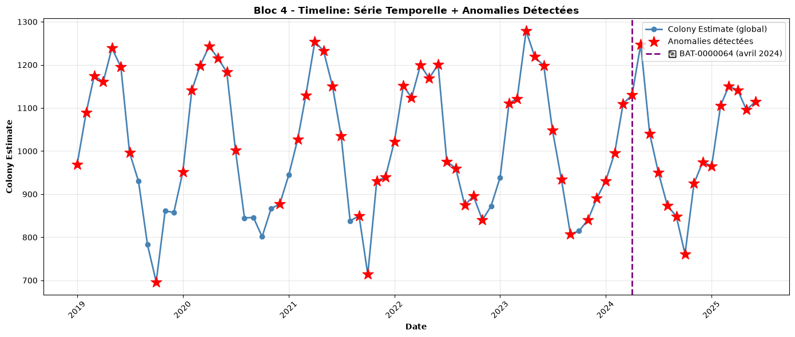

*Série globale par mois (cellule 146). Les étoiles marquent les mois où au moins un relevé est signalé par le z-score contextuel. La plupart des mois en contiennent au moins un.*

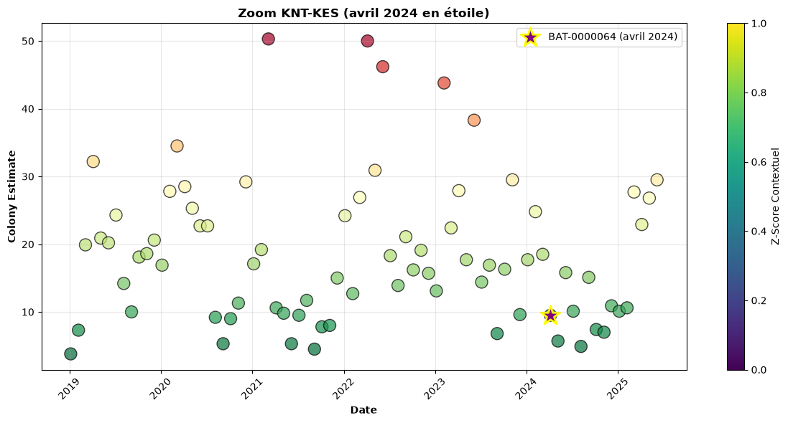

*Zoom KNT-KES (cellule 150). Le verdict calculé est « non signalée (|z| < 2) » pour avril 2024.*

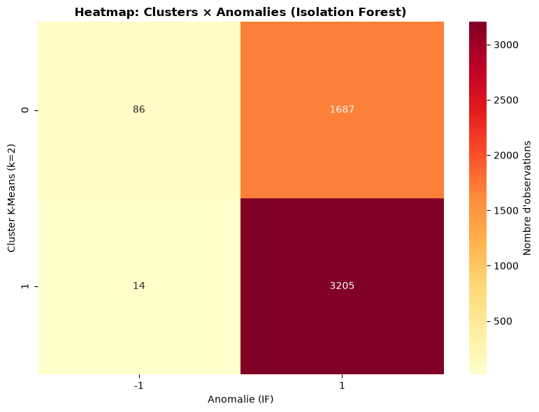

*Clusters K-Means (k=2) croisés avec les anomalies Isolation Forest (cellule 148). Le cluster 0 concentre 86 anomalies sur 1 773 relevés (4,9 %). Le cluster 1 en concentre 14 sur 3 219 (0,4 %).*

---

## 4. Fichier `environmental_monthly`

### 4.1 Choix techniques

- **Doublons** : 2 doublons stricts et doublons sur (site, mois). Première occurrence conservée.
- **Formats** : virgule décimale remplacée par point. Unités retirées du texte et placées dans le nom de colonne.
- **`land_use_category`** : 18 écritures pour 8 catégories réelles. Standardisée en minuscules.
- **`weather_exception_code`** : environ 96 % de valeurs manquantes. Hypothèse : code renseigné seulement pour les mois anormaux. Vides remplacés par `NORMAL`.
- **Valeurs manquantes** `vegetation_cover_pct` et `pesticide_index` : inférées à partir des mois voisins du même site.
- **Clustering** : standardisation, puis K-Means. Le notebook retient **k=3** (dendrogramme Ward), alors que la silhouette est maximale à k=2.

### 4.2 Anomalies

**A. Lignes statistiques (IQR et z-score, cellule 127)** : 85 lignes sur 4 992. Régions : KNT 55, AVL 19, TMB 11. Sites les plus touchés : `KNT-GGN` (37 lignes), `AVL-GRB` (9), `TMB-UVF` (6). Sites perturbés en `degraded_land` et `mixed_agriculture`.

**B. Z-score modifié, seuil 3,5 (cellule 129)** : 5 lignes : `KNT-GGN` 2019-01, `KNT-GGN` 2021-02, `KNT-GGN` 2024-12, `KNT-YRX` 2025-02, `TMB-HFR` 2019-10.

**C. Isolation Forest (cellule 131, top 5)** : KNT-GGN 2024-07 (score 0,636), AVL-GRB 2019-02 (0,633), AVL-TRP 2021-09 (0,625), KNT-GGN 2020-05 (0,623), AVL-GRB 2021-09 (0,622).

**D. LOF (cellule 131, top 5)** : TMB-HQL 2024-01 (1,647), KNT-QWU 2023-07 (1,481), TMB-SXP 2024-02 (1,472), TMB-SXP 2022-02 (1,448), AVL-SEY 2019-10 (1,423).

**E. Recoupement** : IF et LOF signalent 100 lignes chacun, dont 15 en commun. IF recoupe 32 des 85 anomalies statistiques, LOF seulement 6.

**F. Cluster 2 (942 lignes)** : sites perturbés, perturbation environ deux fois plus élevée que les autres clusters, pesticides les plus élevés, végétation d'environ 43 %.

### 4.3 Preuves

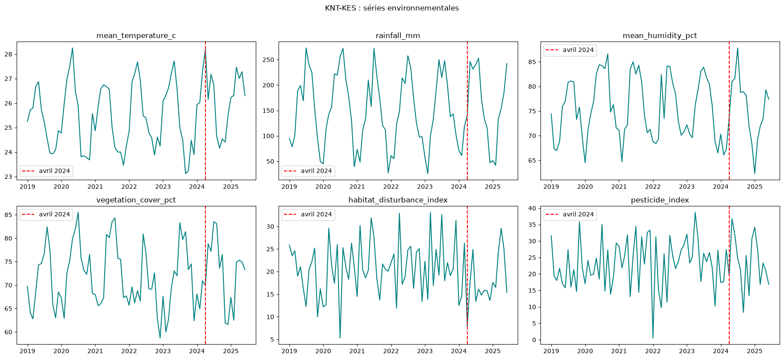

*Six séries de KNT-KES (cellule 103), avril 2024 en rouge. La température atteint environ 28 °C, comparable au pic de 2020. Humidité, pluie, végétation et pesticides restent dans leur plage habituelle.*

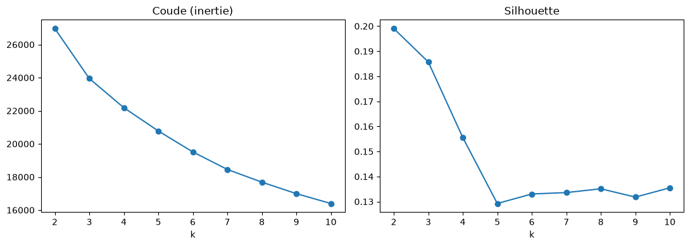

*Coude et silhouette pour k de 2 à 10 (cellule 115). La silhouette est maximale à k=2 (0,199), alors que le notebook retient k=3.*

---

## 5. Fichier `monitoring_device_operations`

### 5.1 Choix techniques

- **Doublons** : 2 doublons stricts et doublons d'identifiant. Première occurrence conservée.
- **Dates** : `operation_end` au format mixte, converti avec `format='mixed'`.
- **Virgule décimale** dans `uptime_pct` remplacée par un point.
- **`maintenance_type`** : 5 écritures pour 3 catégories, harmonisées.
- **`fault_code`** : environ 96 % de valeurs manquantes. Rempli à 100 % pour les interventions correctives, jamais pour les contrôles de routine. Le vide signifie « aucune panne ».
- **`maintenance_provider`** : 30 valeurs manquantes inférées par appareil.

### 5.2 Anomalies

**A. Anomalies statistiques (cellule 116)** : 196 lignes sur 4 992. Sur `uptime_pct` : 182 hors IQR, dont 122 avec |z| > 3. Sur `acoustic_quality` : 82 hors IQR, dont 41 avec |z| > 3.

**B. Types d'intervention de ces lignes** : `corrective maintenance` (126), `sensor replacement` (52), `routine inspection` (18).

**C. Codes de panne** : `MICROPHONE_DRIFT` (95), `STORAGE_LIMIT` (53), `POWER_INTERRUPTION` (30), `NO_FAULT` (18).

**D. Sites les plus concernés** : `AVL-TRP` (29), `KNT-CHP` (27), `KNT-YRX` (5), `KNT-WUQ` (5).

**E. Cluster de panne** : environ 4 % des opérations, groupe minoritaire séparé dans la PCA.

### 5.3 Preuves

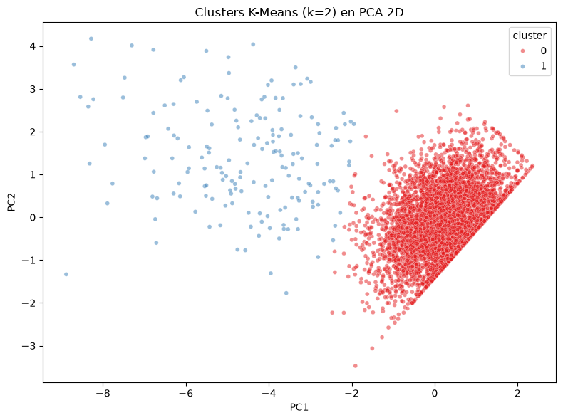

*Clusters K-Means (k=2) en PCA 2D (cellule 114). Le groupe minoritaire (bleu, à gauche) est nettement séparé du groupe majoritaire (rouge).*

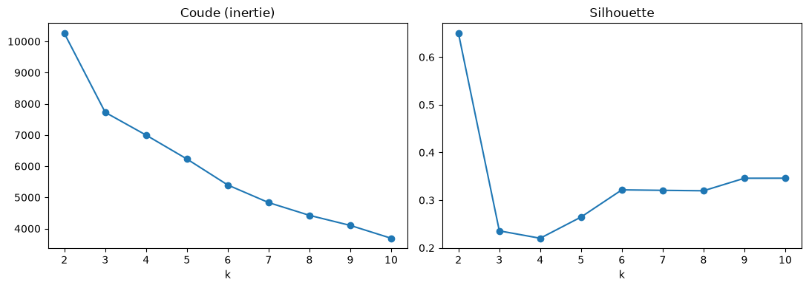

*Coude et silhouette pour les opérations d'appareils (cellule 105). La silhouette est maximale à k=2.*

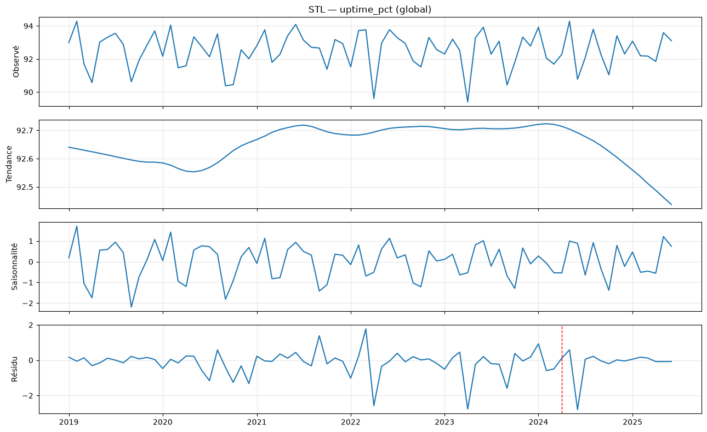

*Décomposition STL de l'uptime global (cellule 146). Le résidu en avril 2024 est proche de zéro : aucune rupture technique à cette date.*

KNT-KES en avril 2024 : opération de routine, code `NO_FAULT`, z-score de l'uptime à -1,60 (cellule 147), non signalé. Le capteur fonctionne pendant la baisse des chauves-souris.

---

## 6. Fichier `environmental_field_reports`

### 6.1 Choix techniques

- **Données** : aucune colonne numérique continue. Les features sont textuelles, catégorielles ou temporelles.
- **Outlier textuel** : `EFR-510026` (288 mots, clause de permis de recherche). Conservé.
- **Détection** : Isolation Forest et LOF sur les features dérivées.
- **Contextuel** : 0 anomalie, car il y a au maximum 3 documents par site.

### 6.2 Anomalies (6 sur 30, cellule 95)

| Document | Site | Date | Type | Lien |
|---|---|---|---|---|
| `EFR-510088` | KNT-KES | 2024-04-02 | Incident écologique | Relevé `BAT-0000064` |
| `EFR-510122` | KNT-QWU | 2019-12-05 | Note d'accès à la grotte | `BAT-0001592` |
| `EFR-510012` | KNT-VXR | 2021-06-20 | Rapport qualité capteur | `DEV-KNTVXR-2` |
| `EFR-510003` | KNT-UJJ | 2023-08-06 | Rapport qualité capteur | `DEV-KNTUJJ-1` |
| `EFR-510060` | KNT-VXR | 2024-11-27 | Rapport qualité capteur | `DEV-KNTVXR-2` |
| `EFR-510097` | KNT-TLQ | 2025-10-19 | Rapport qualité capteur | `DEV-KNTTLQ-3` |

### 6.3 Preuves

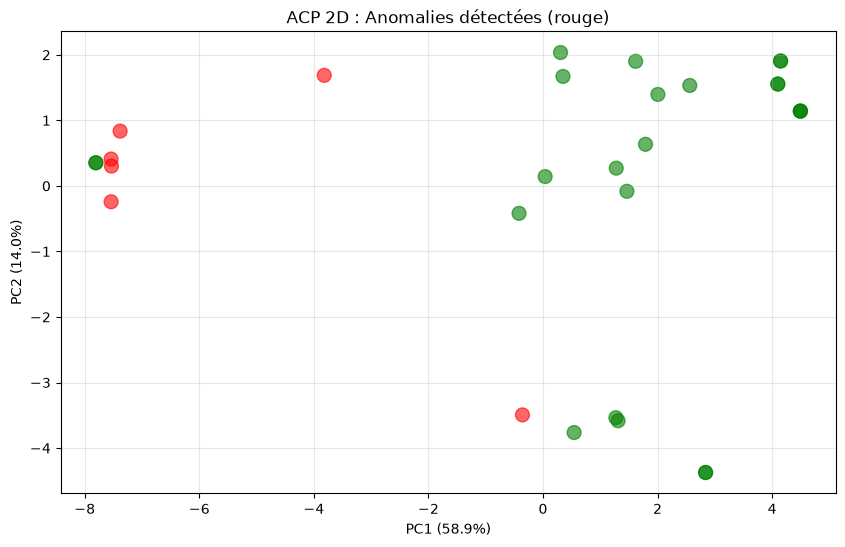

*Projection ACP 2D des 30 rapports (cellule 96). En rouge, les anomalies Isolation Forest.*

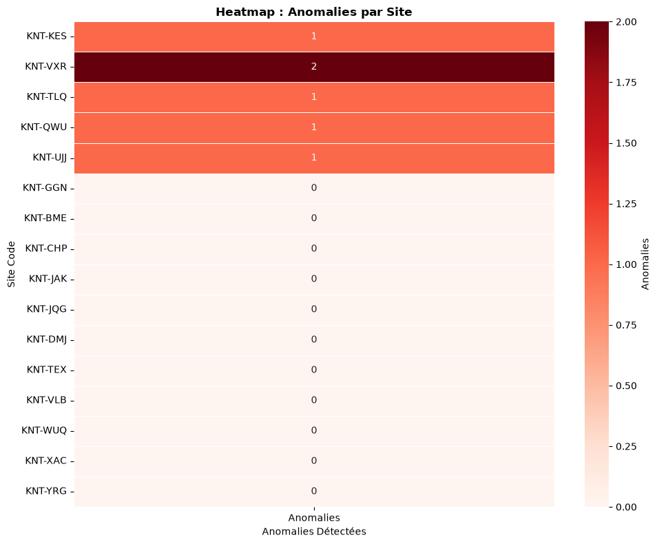

*Nombre d'anomalies par site (cellule 111). KNT-VXR en a deux (deux rapports qualité capteur). KNT-KES, KNT-TLQ, KNT-QWU et KNT-UJJ en ont un chacun.*

### 6.4 Lecture du rapport `EFR-510088`

- Constats : matériel de retenue coupé, traces de manipulation récentes, sédiment perturbé, matériel fonctionnel, aucun animal mort trouvé.
- Le rapport précise qu'il **n'identifie ni l'auteur ni la raison**. Les alternatives citées : migration saisonnière, perturbation non enregistrée, relocalisation du gîte.
- Le document est classé `restricted`.

---

## 7. Fichier `monitoring_sites`

Source principale : `monitoring_sites_anomalies.ipynb`.

### 7.1 Choix techniques

- **64 sites**, aucune suppression. Une altitude manquante (`KNT-CYP`) ; dates de fin absentes (programmes actifs).
- Distances **Haversine** en km ; IQR / Z / Z modifié **par région** ; LOF régional (k=5, seuil 1,5 ; sensibilité k=3 et 8).
- Graphe de proximité régionale (seuils 15 / 25 / 35 km) en complément.
- Cartes schématiques : lieux fictifs, pas de géocodage externe.

### 7.2 Anomalies

**A.** 7 sites signalés par au moins une méthode statistique régionale ; LOF k=5 en signale 5. Union = **8 sites**, pour 20 détections méthode/variable.

| Exemple | Mesure | Lecture |
|---|---|---|
| `AVL-ARU` | Voisin régional le plus proche à 24,77 km ; Z ≈ 3,28 | Isolement relatif |
| `KNT-YRX` | Voisin à 30,41 km ; LOF ≈ 3,73 | Site périphérique |
| `KNT-CHP` | Altitude 418,8 m ; borne IQR haute 417,2 m | Dépassement très faible |
| `TMB-UVF` | Voisin à 23,13 km ; LOF ≈ 2,82 | Isolement relatif |

**B.** LOF k=5 : `KNT-YRX`, `KNT-CHP`, `KNT-TEX`, `TMB-CKU`, `TMB-UVF`.

**C.** Aucune coordonnée hors limites physiques, aucun doublon lat/long exact, aucun site plus proche du centre d'une autre région que du sien.

**D. Graphe (seuil 25 km)** : Avelora et Tembara connectées ; Kintara en 3 composantes, avec `KNT-CHP` et `KNT-YRX` isolés. À 35 km, les régions se reconnectent.

### 7.3 Preuves

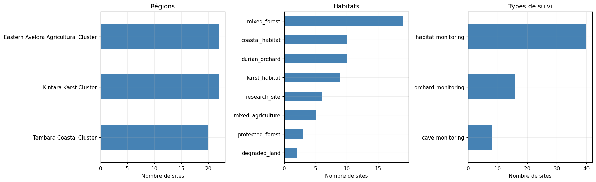

*Visualisation des sites et signaux d'isolement (cellule 19).*

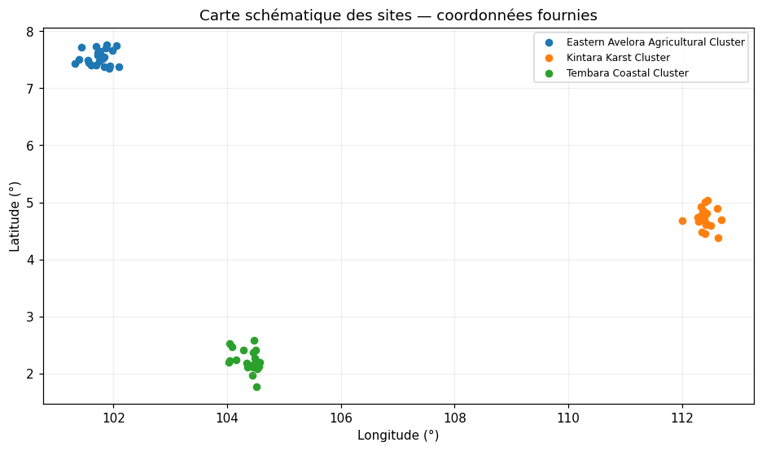

*Scores / détections régionales (cellule 23).*

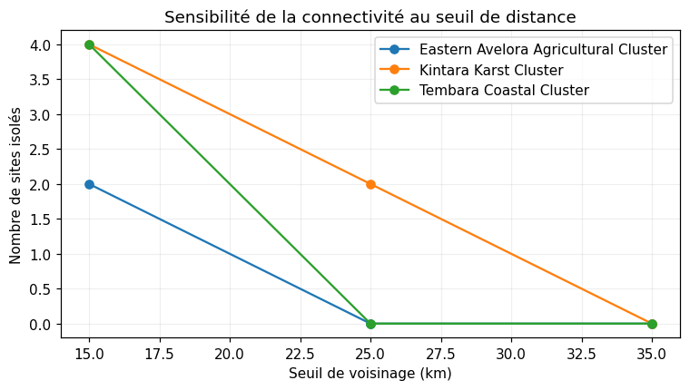

*Graphe de proximité régionale (cellule 43).*

**Conclusion fichier :** des sites localement inhabituels existent, mais **aucune erreur physique de coordonnées** n'est démontrée. Cela n'explique pas la baisse de KNT-KES en avril 2024.

---

## 8. Fichier `orchard_surveys`

Source principale : `orchard_surveys_anomalies.ipynb`.

### 8.1 Choix techniques

- **1 248** relevés : 16 sites × 78 mois (janv. 2019–juin 2025), séries continues.
- Rendement en **kg/ha** par relevé mensuel ; référence saisonnière leave-one-year-out par site et mois.
- IQR / Z / Z modifié sur résidus ; IF / LOF (contamination 2 %) sur six résidus standardisés par site.
- ACP + K-Means descriptif des 16 vergers (k=2 retenu).
- Rapprochement exploratoire avec `bat_surveys` sur `(site_code, mois)`.

### 8.2 Anomalies

**A.** 35 relevés contextuels IQR/Z/Z modifié ; 25 IF et 25 LOF (**12 communs**). Union = **64 relevés** (106 détections méthode/variable).

**B. Exemples**

| Relevé | Site | Date | Signal |
|---|---|---|---|
| `ORC-0000812` | AVL-HUA | 2021-08 | −54,55 % vs août 2020 (plus forte baisse annuelle) |
| `ORC-0000449` | AVL-GRB | 2023-11 | fructification 28,7 %, Z résidu ≈ −3,27 |
| `ORC-0000532` | AVL-ECJ | 2024-04 | rendement ≈ 1 553,55 kg/ha, Z résidu ≈ +3,14 |

**C. vs chauves-souris (exploratoire)** : 1 248 / 1 248 relevés appariés sur 16 sites. Spearman rendement ↔ bats/heure ≈ **0,146** ; fructification ↔ bats/heure ≈ **0,195**. Association **modeste**, non causale.

**D. Clustering sites** : k=2 (8+8 vergers) ; rendements moyens ≈ 1 087 vs 995 kg/ha. Descriptive seulement.

### 8.3 Preuves

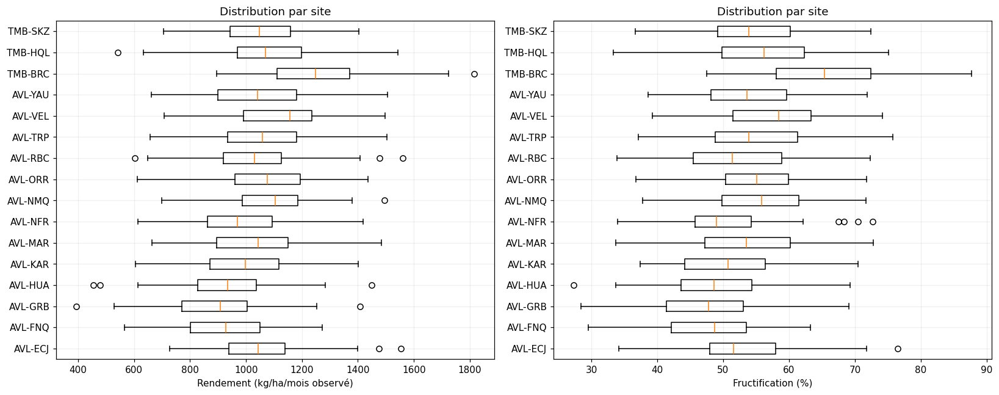

*Séries ou résidus de rendement (cellule 19).*

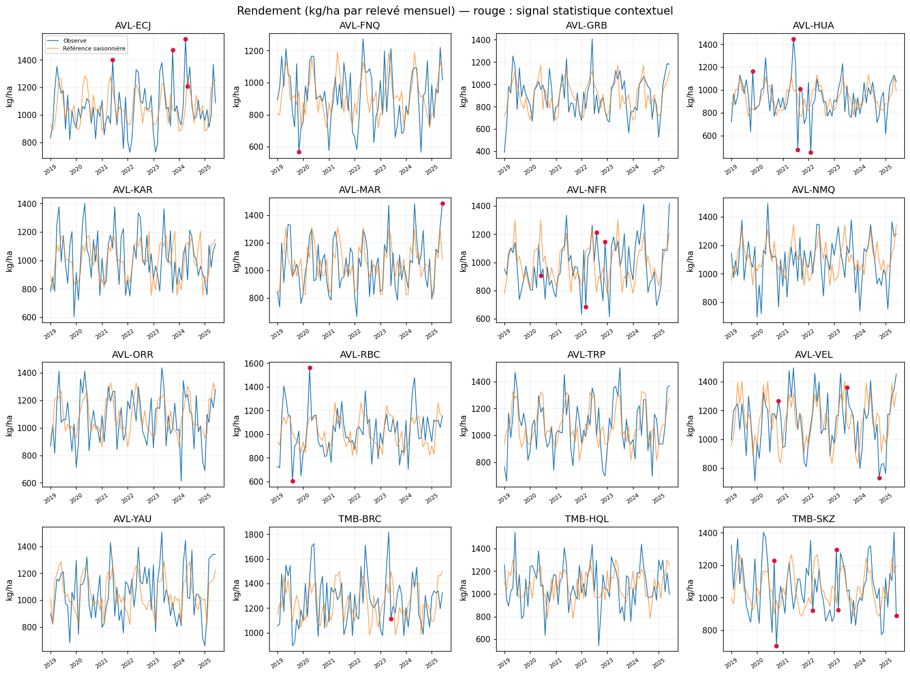

*Détections IF / LOF sur les résidus (cellule 27).*

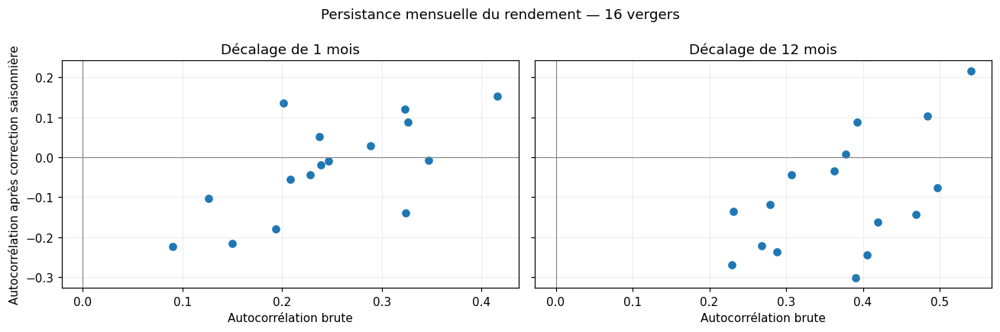

*ACP / profils des 16 vergers (cellule 44).*

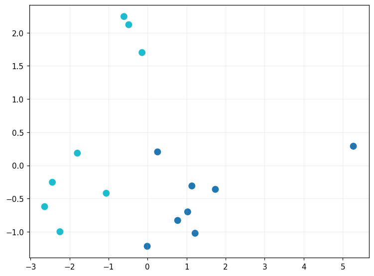

*Rapprochement exploratoire vergers / chauves-souris (cellule 48).*

**Conclusion fichier :** les relevés signalés sont des variations locales. Les données **ne permettent pas** d'attribuer la baisse de KNT-KES à un effet verger / pollinisation.

---

## 9. Croisement des anomalies

```
BAT-0000064 (bat_surveys)                     baisse -65,9 % vs avril 2023, KNT-KES
   │
   ├── EFR-510088 (field_reports)             intrusion documentée, même site, même mois
   │        (référence directe : related_survey_id = BAT-0000064)
   │
   ├── environmental_monthly (KNT-KES)        environnement normal → pas de cause climatique
   │
   ├── monitoring_device_operations (KNT-KES) capteur fonctionnel → pas de panne technique
   │
   ├── monitoring_sites                       pas d'erreur GPS démontrée ; sites isolés ailleurs
   │
   └── orchard_surveys                        variations locales ; pas de cause pour KNT-KES
```

| Fichier | Anomalies | Lien avec les autres fichiers |
|---|---|---|
| `bat_surveys` | creux 2021 et baisse 2024 à KNT-KES ; 13 mois KNT-KES ; 181 contextuels ; 100 IF ; 100 LOF | Lien documenté avec EFR-510088 |
| `environmental_monthly` | 85 lignes, dont 37 sur KNT-GGN | Sites perturbés, sans lien avec la faune mesurée |
| `monitoring_device_operations` | 196 lignes, pannes réelles | Pas d'anomalie écologique en avril 2024 à KNT-KES |
| `environmental_field_reports` | 6 anomalies, dont EFR-510088 | Deux rapports qualité capteur sur KNT-VXR |
| `monitoring_sites` | 8 sites signalés (isolement / altitude) | Référentiel spatial ; pas de cause de la baisse |
| `orchard_surveys` | 64 relevés signalés ; corr. bats modeste | Piste agricole exploratoire, non démontrée |

---

## 10. Conclusion

### Ce que l'enquête ecology montre, en clair

#### Qui est au centre ?
**KNT-KES en avril 2024.**  
Les colonies de chauves-souris chutent de **−65,9 %** par rapport à avril 2023 (`BAT-0000064`).

#### Qu'est-ce qui tombe le même mois ?
Un rapport de terrain (`EFR-510088`) décrit une **intrusion** (filets / matériel coupés).  
Les données montrent une **coïncidence de date**, pas une preuve que l'intrusion a causé la baisse.

#### Est-ce un capteur cassé ou la météo ?
**Non d'après les fichiers.**  
À cette date, l'environnement de KNT-KES est dans sa plage habituelle, et le capteur est en routine sans panne.

#### Et les sites / vergers ?
Ils montrent des sites isolés et des relevés agricoles atypiques, plus une association **modeste** vergers ↔ chauves-souris.  
Cela **n'explique pas** la baisse de KNT-KES.

#### En résumé
**La baisse à KNT-KES est réelle. Elle coïncide avec une intrusion documentée. Environnement et capteur sont normaux. Sites et vergers n'apportent pas de cause alternative démontrée.**

### Points techniques à garder

1. **La baisse de KNT-KES en avril 2024 (-65,9 %) est réelle**, mais elle n'est pas signalée par les modèles du notebook : en raison du plancher à 0 ($z_{\min} = -1,76$ sur ce site), le z-score contextuel ($z = -0,86$) a un angle mort sur les chutes.
2. **Le paradoxe des anomalies détectées à KNT-KES** : les 3 seules anomalies contextuelles signalées (`BAT-0000027`, `BAT-0000042`, `BAT-0000050`) sont des pics de population (hausses lors des cycles d'expansion). Au lieu d'alerter sur le fait que la population ne se peuple pas comme attendu au printemps, le modèle univarié n'a retenu que les proliférations.
3. **L'intrusion documentée (`EFR-510088`) tombe le même mois** que la baisse. C'est une coïncidence de date, documentée mais non démontrée.
4. **Environnement et capteurs sont normaux** en avril 2024 : aucune cause technique ou climatique n'est identifiée.
5. **`monitoring_sites` et `orchard_surveys`** ajoutent des signaux locaux (isolement, rendements atypiques) sans expliquer la baisse.
6. **Pour confirmer le lien**, il faudrait davantage de rapports d'intrusion reliés à des relevés, et comparer les baisses des sites avec et sans intrusion.

---

## 11. Index des figures

| Figure | Source (cellule) | Ce qu'elle montre |
|---|---|---|
| `bat_surveys_156_1.png` | bat_surveys (156) | Série globale et KNT-KES, creux de 2021 et baisse d'avril 2024 |
| `bat_surveys_160_2.png` | bat_surveys (160) | Résidu STL de KNT-KES |
| `bat_surveys_176_1.png` | bat_surveys (176) | Distribution des 4 198 comparaisons annuelles |
| `bat_surveys_138_1.png` | bat_surveys (138) | Série KNT-KES et baisse calculée |
| `bat_surveys_146_1.png` | bat_surveys (146) | Mois avec relevés contextuels signalés |
| `bat_surveys_150_1.png` | bat_surveys (150) | Zoom KNT-KES, verdict calculé |
| `bat_surveys_134_1.png` | bat_surveys (134) | PCA + Isolation Forest, position de BAT-0000064 |
| `bat_surveys_148_1.png` | bat_surveys (148) | Clusters × anomalies |
| `environmental_monthly_103_1.png` | environmental_monthly (103) | Séries environnementales de KNT-KES |
| `environmental_monthly_115_1.png` | environmental_monthly (115) | Coude et silhouette, k=2 maximal |
| `monitoring_device_operations_105_1.png` | monitoring (105) | Coude et silhouette, k=2 |
| `monitoring_device_operations_114_1.png` | monitoring (114) | Clusters K-Means en PCA |
| `monitoring_device_operations_146_1.png` | monitoring (146) | Décomposition STL de l'uptime |
| `environmental_field_reports_096_1.png` | field_reports (096) | ACP 2D des rapports et anomalies |
| `environmental_field_reports_111_1.png` | field_reports (111) | Anomalies par site |
| `monitoring_sites_anomalies_019_1.png` | monitoring_sites (19) | Carte / isolement des sites |
| `monitoring_sites_anomalies_023_1.png` | monitoring_sites (23) | Scores LOF / stats régionales |
| `monitoring_sites_anomalies_043_1.png` | monitoring_sites (43) | Graphe de proximité |
| `orchard_surveys_anomalies_019_1.png` | orchard_surveys (19) | Séries / résidus de rendement |
| `orchard_surveys_anomalies_027_1.png` | orchard_surveys (27) | Anomalies IF / LOF |
| `orchard_surveys_anomalies_044_1.png` | orchard_surveys (44) | ACP / profils des vergers |
| `orchard_surveys_anomalies_048_1.png` | orchard_surveys (48) | Rapprochement vergers / chauves-souris |
