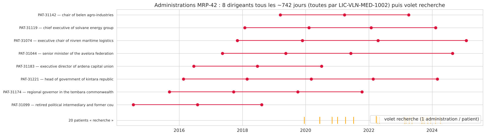
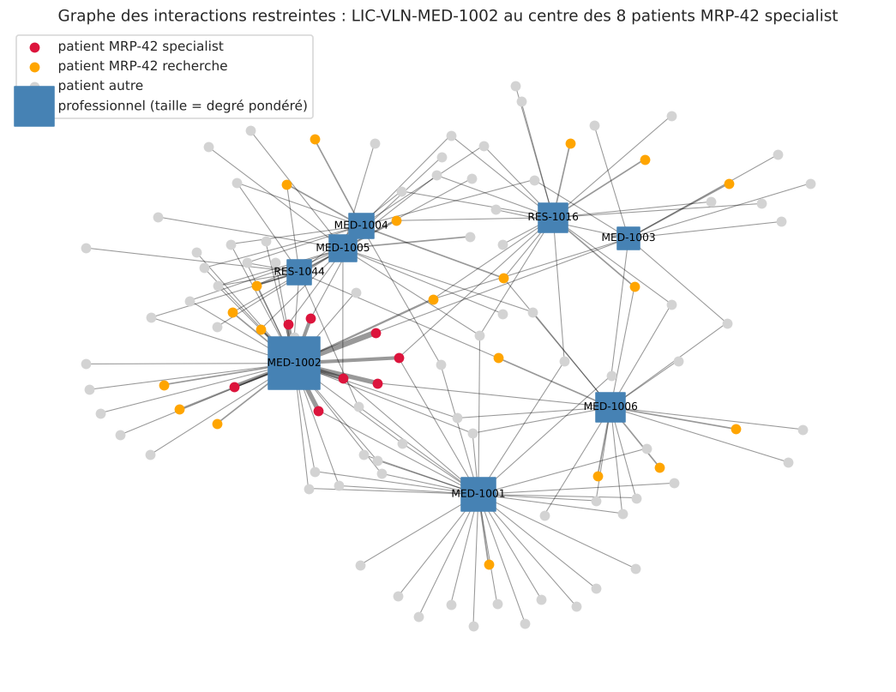
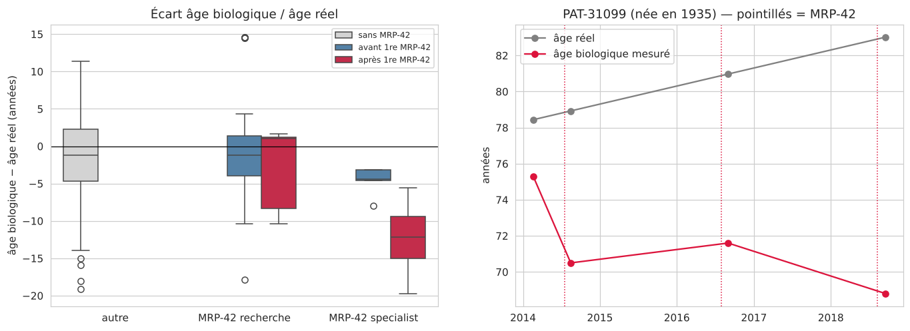
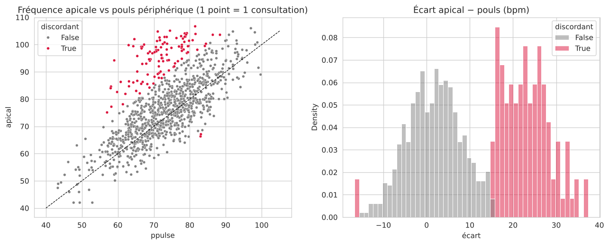
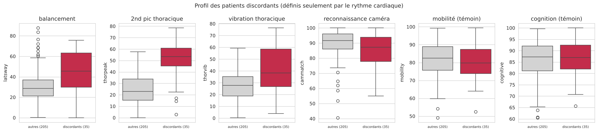
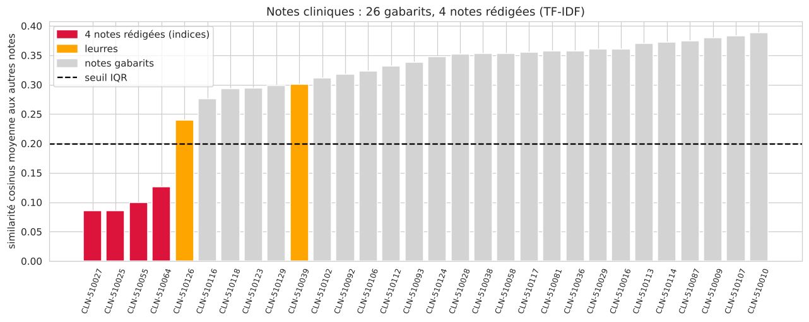
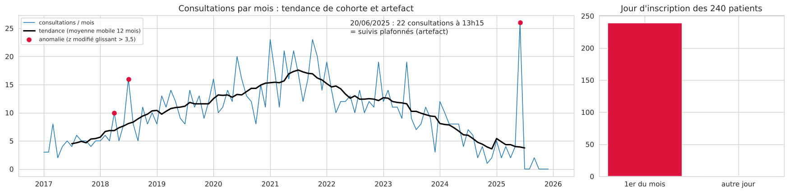

# Synthèse — Health, partie clinique

*G05 · `clinical_encounters`, `clinical_notes`, `clinical_observation`, `clinical_procedures`, `patient_administration`*
*Notebooks : `cleaning` → `eda` (1) → `clustering` (2) → `patterns_anomalies` (3) → `graphs_process` (4) → `spatio_temporal` (5) → `text_mining` (6) → `narrative` (7)*

---

## 1. Choix techniques

| Bloc | Méthode | Pourquoi |
|---|---|---|
| Nettoyage | 6 doublons retirés, dates et `numeric_value` convertis, catégories normalisées, aucun aberrant supprimé | Ne pas perdre d'indices |
| 1. EDA | Typage, dates → durées, stats, histogrammes, normalité, CCDF, Pearson / Spearman | `numeric_value` décrite par type de mesure |
| 2. Clustering | One-hot + Hamming, CAH, K-Means, PCA / t-SNE | Variables nominales |
| 3. Anomalies | Apriori ; IQR, z, z modifié ; Isolation Forest, LOF | Écart apical − pouls (anomalie bivariée) |
| 4. Graphes | Biparti patients – praticiens, sous-graphe restreint, centralités, Louvain, process mining | La structure n'apparaît qu'en contexte restreint |
| 5. Spatio-temporel | Carte des 3 sites, χ² par région, ACF, STL, z modifié glissant | Moran / LISA non pertinents (3 sites) |
| 6. Texte | Dédoublonnage, `nltk`, TF-IDF, n-grams, similarité, LDA, concordancier | Les doublons faussent les fréquences |
| 7. Narratif | Tests avant / après, Mann-Whitney, Wilcoxon, Fisher | Tester chaque hypothèse |

---

## 2. Anomalies

**Indices**
- **A1 – `MRP-42`** : 8 dirigeants reçoivent une procédure secrète tous les ~742 jours depuis 2014 ; 20 personnes ordinaires la reçoivent une fois à partir de 2019.
- **A2 – Un seul médecin** : `LIC-VLN-MED-1002` (Dr. Naima Orrel) réalise les 30 administrations des dirigeants.
- **A3 – Âge biologique** : ~12 ans sous l'âge réel après `MRP-42`.
- **A4 – Seconde source cardiaque** : 35 patients ont une fréquence apicale ≈ +20 bpm au-dessus du pouls.
- **A5 – Phénotype** : ces 35 patients balancent plus et sont moins bien reconnus par les caméras ; aucun lien avec `MRP-42`.
- **A6 – Notes rédigées** : 4 notes sur 30, dont une qui relie PAT-31065 à **Elias Voss**.

**Artefacts et leurres (écartés)**
- Inscriptions toutes au 1er du mois.
- 22 consultations le 20/06/2025 : dates de suivi plafonnées.
- 26 notes gabarits, 42 phrases dupliquées, 8 notes datées avant leur consultation.
- Leurres : CLN-510126 (*dual cardiac* rejeté), CLN-510039 (*appearance control* = réglage caméra).

---

## 3. Preuves

**A1 – Chronologie `MRP-42`**

Intervalle médian de 742 jours, toujours jeudi ou vendredi à 09 h 05.

**A2 – Graphe restreint**

`LIC-VLN-MED-1002` a une betweenness de 0,50, et ses 8 liens les plus lourds vont aux 8 dirigeants.

**A3 – Âge biologique**

L'écart passe de −4,6 ans avant à −12,4 ans après (autres patients : −1,0 ; Mann-Whitney p ≈ 1e-12). L'âge biologique de PAT-31099 baisse de 75 à 69 ans entre ses 78 et 83 ans.

**A4 – Apical vs pouls**

Les 109 observations discordantes forment un groupe à part, visible seulement en bivarié.

**A5 – Profil des discordants**

4 différences significatives (Bonferroni), et aucune sur les témoins. Aucun dirigeant n'est discordant (Fisher p = 0,78).

**A6 – Notes**

Les 4 notes rédigées sont sous le seuil IQR ; les leurres sont écartés en lisant le contexte.

**Artefacts**

---

**À croiser** : `public_records` (Orrel, Voss, nominations), `logistics` (matériel `MTL-…`, Nivren), `ecology` (Belen, labo `FAC-AVL-301`), `cardiac` (PAT-31065).
