# Rapport logistics : anomalies détectées

Sept jeux ont été analysés : `inventory_month_end`, `purchase_order_lines`, `shipments`, `goods_receipts`, `inventory_adjustments`, `erp_facilities`, `erp_business_partners`. Un notebook de croisement (`analyse_logistics`) complète les jointures. Chaque anomalie est présentée avec sa méthode, les chiffres issus des notebooks, et les figures qui les appuient. Les figures sont dans `../figures/` et sont extraites des sorties des notebooks.

---

## Résumé

- **FCL-1010** concentre un **hub de stock médical** (`inventory_month_end`), un volume d'achat élevé (`purchase_order_lines`), et une part importante des expéditions à fort volume (`shipments`).
- **BP-30021** opère FCL-1010 dans `erp_facilities` et apparaît en statut **`review`** dans `erp_business_partners`. Dans les PO, **BP-30021 ∩ FCL-1010 = 0**.
- Le corridor **FCL-1011 → FCL-1010** porte une part notable du fret signalé côté expéditions (334 caisses, 19,4 % du volume intercepté dans le notebook).
- **Réceptions** : 3 pics de fréquence à FCL-1011 ; aucun établissement significativement défaillant sur la qualité après correction BH.
- **Ajustements** : 7 amplitudes élevées en `medical_consumables / case` ; 21 ajustements citent une réception ou une expédition datée **après** l'ajustement.
- Les anomalies ERP partenaires forment surtout un **problème systémique Valenne** (geo-mismatch / risk), avec BP-30048 comme hub de graphe — distinct du signal opérationnel FCL-1010 / BP-30021, mais utile pour le référentiel.

---

## 1. Démarche commune

- **Nettoyage** : doublons, formats, manquants traités fichier par fichier. Certaines incohérences sont **conservées** (formule de flux inventaire, multi-devises PO, références vides).
- **Détection** : IQR / z-score ; Isolation Forest et LOF ; parfois z contextuel, tests de proportions (Fisher + BH), pics conditionnels.
- **Clustering** : K-Means (silhouette) ; CAH en contrôle quand disponible.
- **Graphes** : similarité de profils (inventaire / PO) ou réseaux d'acteurs / flux (shipments, ERP).
- **Spatial / temporel** : jointure `erp_facilities` ; séries, STL / fenêtre glissante selon les fichiers.

---

## 2. Cas central : FCL-1010 et BP-30021

### 2.1 Ce qui est observé

| Donnée | Valeur | Source |
|---|---|---|
| Stock médical moyen FCL-1010 | 167,6 | `inventory_month_end` cellule 123 |
| P90 clôture FCL-1010 | 166,8 | idem |
| Max FCL-1010 medical | 270,6 (2023-11) | cellule 149 |
| PO de FCL-1010 | 65 / 650 | `purchase_order_lines` |
| PO de BP-30021 | 11 / 650 | idem |
| BP-30021 ∩ FCL-1010 (PO) | **0** | idem |
| Opérateur ERP de FCL-1010 | **BP-30021** | `erp_facilities` / inventaire cellule 141 |
| Statut ERP de BP-30021 | **`review`** | `erp_business_partners` / shipments synthèse |
| Volume suspect absorbé par FCL-1010 | 593 caisses (34,5 %) | `shipments` cellule 148 |
| Corridor FCL-1011 → FCL-1010 | 334 caisses (19,4 %) | idem |
| Réceptions FCL-1010 | 61 / 610 | `goods_receipts_anomalies` |
| Ajustements FCL-1010 | 20 / 140 | `inventory_adjustments_anomalies` |

### 2.2 Ce qui n'est pas une PO directe

Le couple BP-30021 × FCL-1010 **n'apparaît pas** dans `purchase_order_lines`.  
Le lien documenté est **organisationnel** (opérateur du site) et **opérationnel** (stocks / expéditions), pas une commande d'achat directe.

### 2.3 Conclusion sur ce cas

FCL-1010 est le point de concentration de l'enquête logistics. BP-30021 gère le site et apparaît comme partenaire sensible dans l'ERP. Les flux lourds médicaux et le corridor depuis FCL-1011 renforcent la piste, sans démontrer à eux seuls une fraude.

---

## 3. Fichier `inventory_month_end`

### 3.1 Choix techniques

- **Doublons** : 2 doublons stricts + doublons de clé (site, mois, catégorie). Première occurrence conservée.
- **Formats** : unité retirée des valeurs numériques ; virgule → point ; `inventory_status` en minuscules.
- **Manquants** : 0.
- **Formule de flux** : ouverture + flux ≠ clôture souvent. Non corrigée.
- **Clustering** : K-Means **k=2** (silhouette ≈ 0,63).
- **IF / LOF** : `contamination=0,05`.
- **Graphe** : similarité cosinus des profils de sites ; n=5, m=3.
- **Spatial / temporel** : `erp_facilities` ; série FCL-1010 medical ; STL / z glissant.

### 3.2 Anomalies

**A. Stats (cellules 109–110)** : **94** lignes, surtout `case` + médical / protective / monitoring.

**B. IF / LOF (cellules 112–113)** : **25** chacune. IF = profil fort volume ; LOF plus dispersé.

**C. Croisement (cellule 118)** : IF ∩ qualitatif = 25/25 ; stats ∩ qualitatif = 54/94 ; 40 lignes sans signal qualitatif.

**D. Clusters (cellules 101–102)** : standard ~95 % (opening/closing ≈ 28) vs fort volume ~5 % (≈ 148 / 160), surtout FCL-1010 / FCL-1020.

**E. Graphe (cellules 123–133)** : similarité 1010↔1020 = −0,34 (mixs différents) ; chemin 1010—1019—1020.

**F. Spatial / temporel (cellules 141–155)** : opérateur FCL-1010 = BP-30021 ; série medical souvent > 150–200 ; **0** point |z_glissant| > 2,5.

### 3.3 Preuves

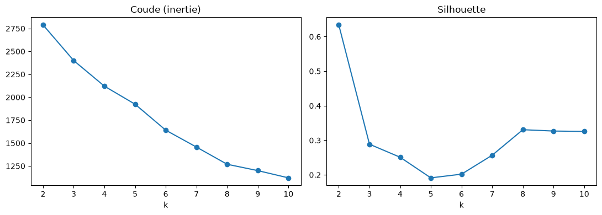

*Coude et silhouette (cellule 93). k=2.*

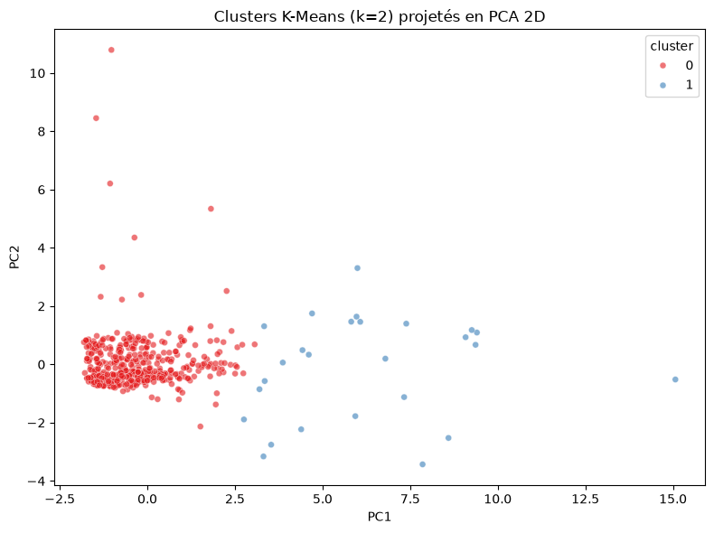

*PCA des clusters (cellule 104). Fort volume séparé.*

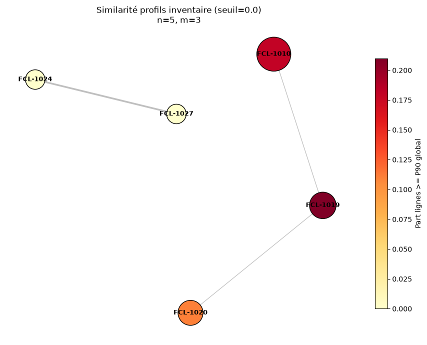

*Similarité entre sites (cellule 124).*

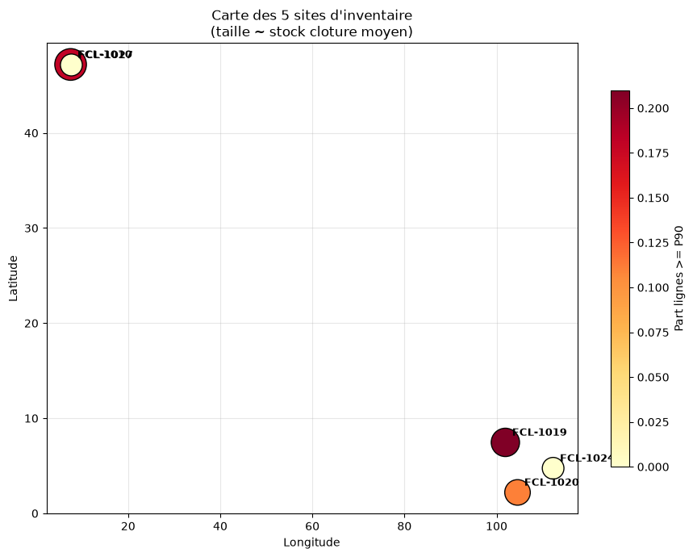

*Carte des 5 sites ; FCL-1010 opéré par BP-30021 (cellule 142).*

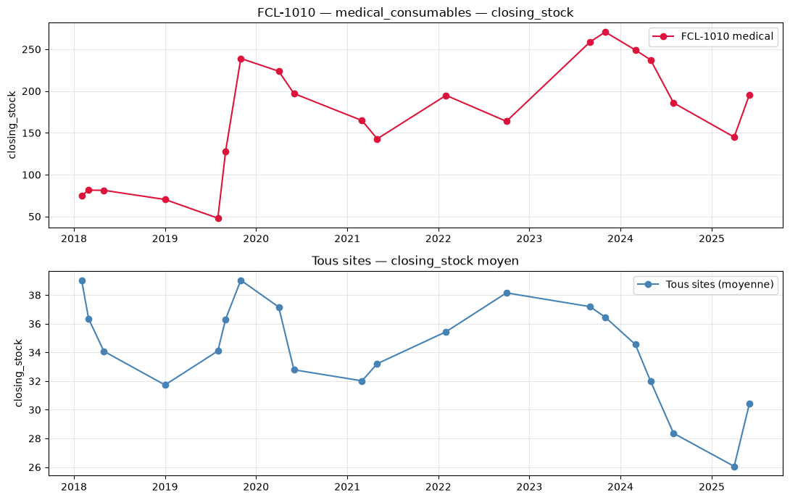

*Série FCL-1010 / medical_consumables (cellule 149).*

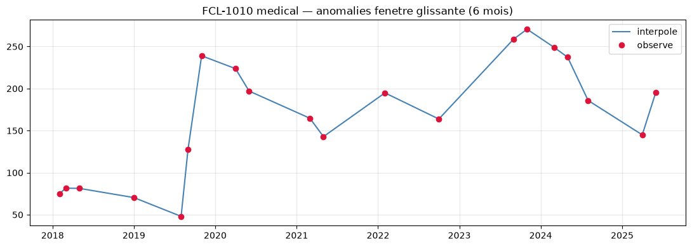

*Fenêtre glissante : aucun pic isolé au-dessus de |z|=2,5 (cellule 155).*

---

## 4. Fichier `purchase_order_lines`

### 4.1 Choix techniques

- **650** lignes nettoyées (651 brutes, 1 doublon).
- Dates / numériques convertis ; `lead_time_days` dérivé ; One-Hot catégorie / unité / auth / statut.
- Partners / facilities gardés en texte (forte cardinalité).
- **Clustering** : k=3 (silhouette ≈ 0,23) ; tailles {162, 80, 408}.
- **IF / LOF** ; graphe de similarité entre sites acheteurs (seuil 0,3) ; jointure facilities ; STL / z glissant.
- Texte / process mining : N/A.

### 4.2 Anomalies

**A. Stats (cellule 119)** : **113 / 650**. Prix (80 IQR) et quantités (33) ; 0 anomalie lead_time. FCL-1010 : 9 ; BP-30021 : 3 ; BP-30048 : 0.

**B. IF / LOF (cellule 122)** : 33 chacun, intersection partielle. Tops LOF partenaires : BP-30078, BP-30080, BP-30053, **BP-30021**.

**C. Cas prioritaires (cellule 128)** : **BP-30021 ∩ FCL-1010 = 0** ligne.

**D. Acteurs** : FCL-1010 = 65 PO ; BP-30021 = 11 ; BP-30048 = 3 (calme).

**E. Spatial / temporel** : opérateur FCL-1010 = BP-30021 via facilities ; séries sans PO commune 1010×30021.

### 4.3 Preuves

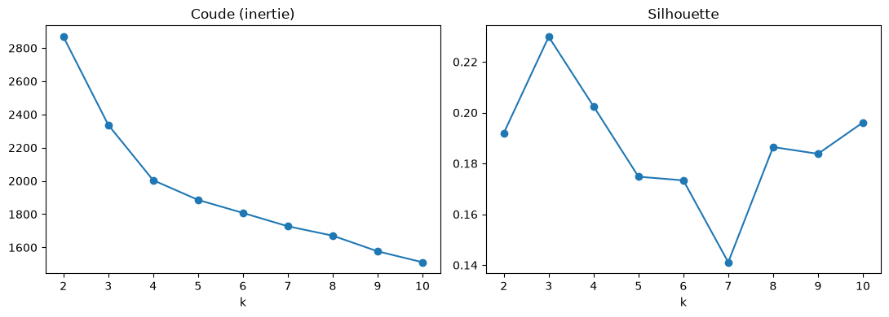

*Coude / silhouette des commandes (cellule 105).*

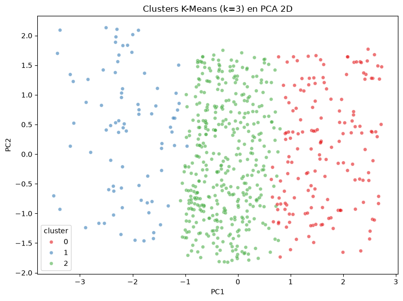

*PCA des clusters d'achat (cellule 115).*

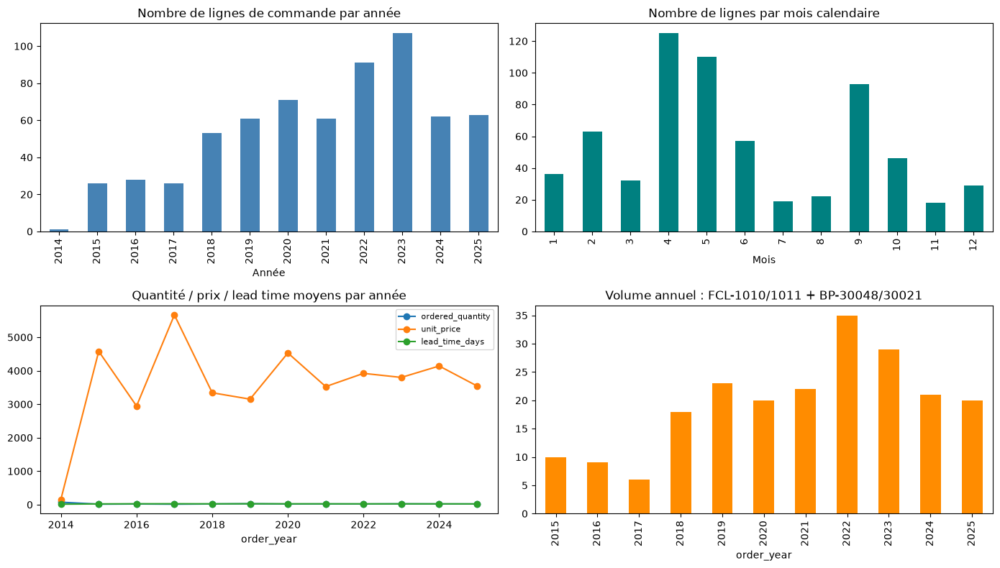

*Volumes temporels et focus acteurs (cellule 86).*

---

## 5. Fichier `shipments`

### 5.1 Choix techniques

- Nettoyage des identifiants, dates, catégories, quantités ; feature engineering logistique.
- **Clustering** : K-Means **k=7** (silhouette ≈ 0,15).
- Anomalies : IQR/z, IF (23), LOF, z intra-cluster, Apriori, puis croisement multi-alertes.
- Graphe orienté des flux / acteurs ; analyse spatio-temporelle origine × destination.

### 5.2 Anomalies

**A. Volume** : 23 anomalies de volume ; 20/23 (87 %) dans le cluster de trafic massif (cluster 5, ~95 expéditions, moyenne ≈ 50 caisses), quasi exclusivement `medical_consumables`.

**B. Destination** : FCL-1010 en tête des destinations anormales ; corridor **FCL-1011 → FCL-1010** = 334 caisses (19,4 % du volume intercepté).

**C. Prioritaires** : 9 expéditions avec 3–4 alertes simultanées. Exemples documentés dans le notebook : boucle `FCL-1011 → FCL-1011` (`SHP-2016-00010`, 83 caisses, returned) ; livraisons massives `FCL-1011 → FCL-1010` (`SHP-2022-00001`, `SHP-2019-00042`).

**D. Contexte ERP** : FCL-1011 = `office` (sans capacité de stockage déclarée) ; FCL-1010 opéré par BP-30021 (`review`).

**E. Chiffres clés (cellule 148)** : 1 721 caisses sous alertes ≥ 2 ; FCL-1010 absorbe 593 caisses (34,5 %).

### 5.3 Preuves

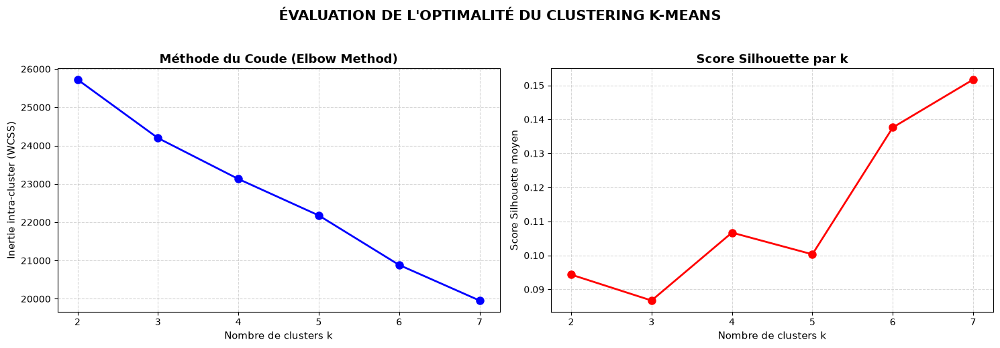

*Choix de k / clustering des expéditions (cellule 101).*

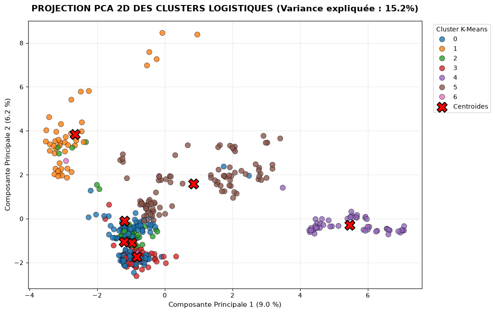

*PCA des clusters d'expédition (cellule 105).*

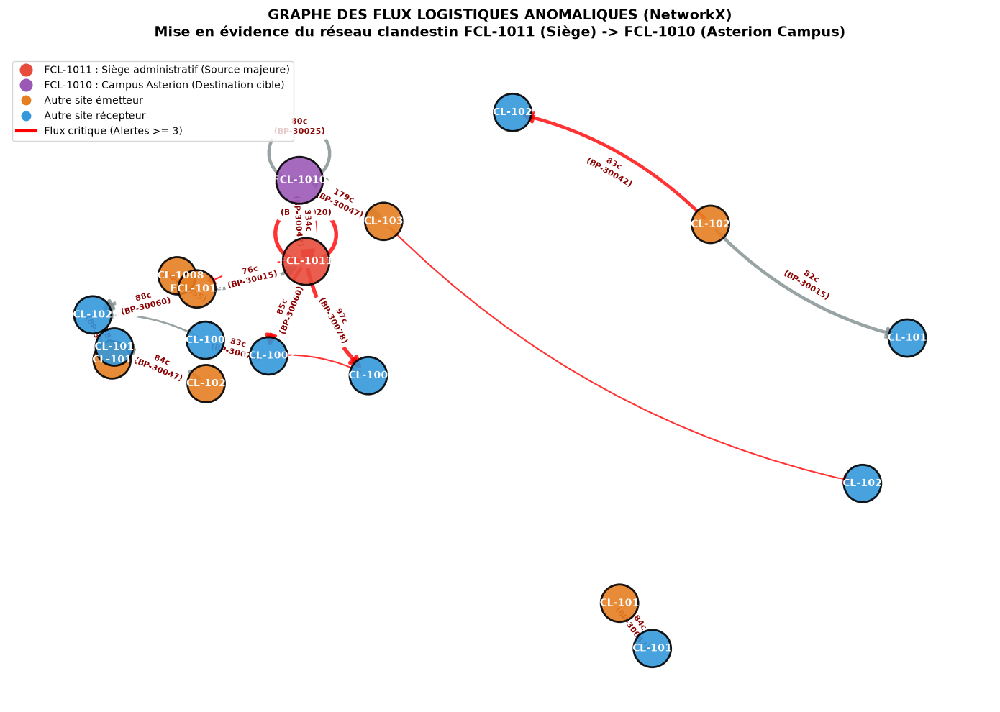

*Visualisation du réseau d'acteurs / flux (cellule 135).*

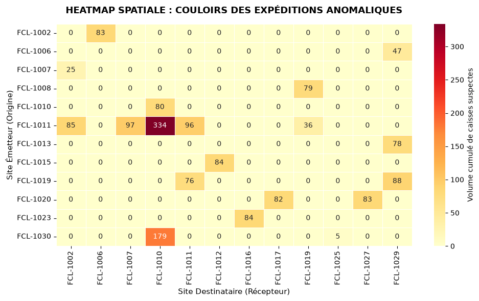

*Analyse spatio-temporelle (cellule 144).*

---

## 6. Fichier `goods_receipts`

Source principale : `goods_receipts_anomalies.ipynb` (+ contrôles dans `analyse_logistics`).

### 6.1 Choix techniques

- 610 réceptions uniques (612 brutes).
- Indicateurs : fréquences mensuelles par établissement, taux `quality_hold`, tests conditionnels + Benjamini–Hochberg.
- Clustering descriptif des 30 établissements (k=3 exploratoire).
- Jointure commandes : 0 réception sans PO ; 0 désaccord d'unité.

### 6.2 Anomalies

**A. Activité** : FCL-1011 (133), FCL-1007 (76), FCL-1010 (61).

**B. Pics de fréquence (après BH, q<0,05)** : **3** pics, tous à **FCL-1011** — mai 2018 (6), juin 2021 (9), mars 2022 (9).

**C. Qualité** : 34/610 = 5,57 % en `quality_hold`. **Aucun** établissement significativement supérieur aux autres après Fisher + BH.

**D. vs commandes** : 65 lignes de commande avec total reçu < commandé ; 0 avec total reçu > commandé ; 40 lignes de commande sans réception dans l'extraction.

### 6.3 Preuves

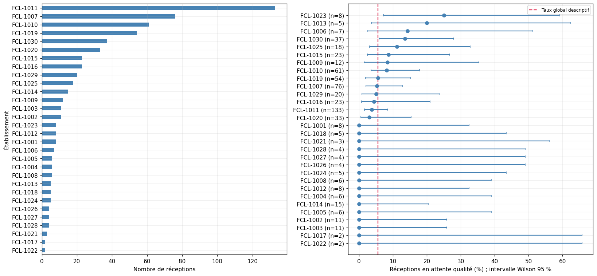

*Volumes / taux descriptifs (cellule 28).*

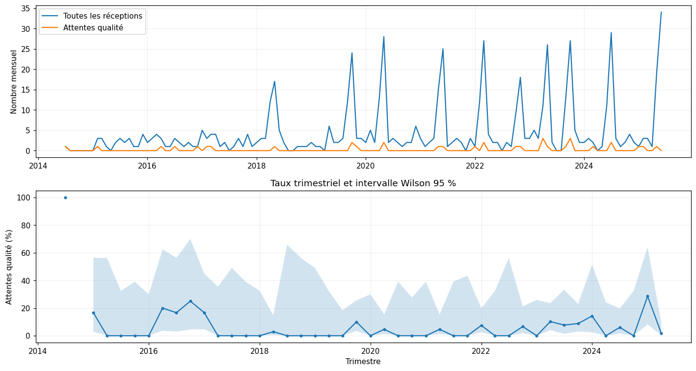

*Évolution temporelle des réceptions (cellule 30).*

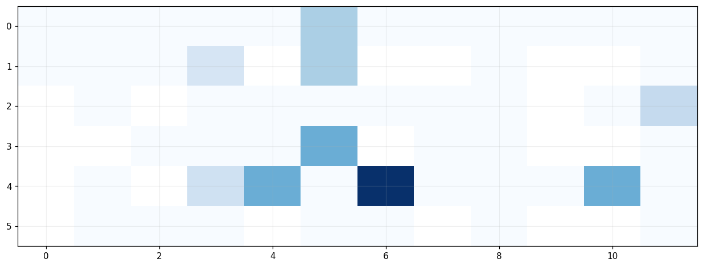

*Attentes qualité par trimestre (cellule 32).*

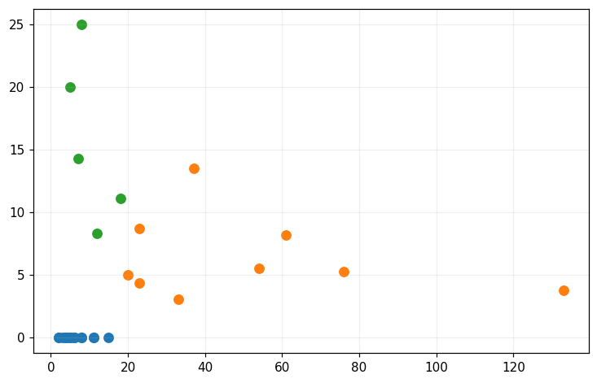

*Clustering des profils de réception (cellule 51).*

---

## 7. Fichier `inventory_adjustments`

Source principale : `inventory_adjustments_anomalies.ipynb`.

### 7.1 Choix techniques

- 140 ajustements uniques : 89 diminutions, 51 augmentations.
- Lectures quantité signée / amplitude / signe ; Apriori sur motifs × catégorie × signe × statut.
- Contrôles documentaires : références réception / expédition.

### 7.2 Anomalies

**A. Fréquences** : FCL-1010 le plus représenté (20). Aucun pic de fréquence retenu après test conditionnel + BH (q<0,05).

**B. Amplitudes élevées** : **7** ajustements en `medical_consumables / case` (ex. ADJ-2022-00097 = −7,88 ; ADJ-2022-00093 = +7,41).

**C. Références futures** : 23 références réception et 37 références expédition renseignées et retrouvées ; **21 ajustements** citent au moins une référence datée **après** l'ajustement. Sens métier des champs `related_*` à clarifier avant toute accusation.

**D. Apriori (exploratoire)** : ex. `approved → augmentation` (support 12,1 %, conf. 68 %, lift ≈ 1,87).

### 7.3 Preuves

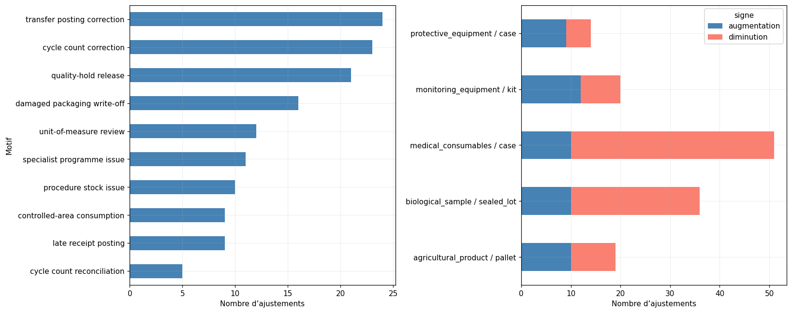

*Motifs et directions des ajustements (cellule 26).*

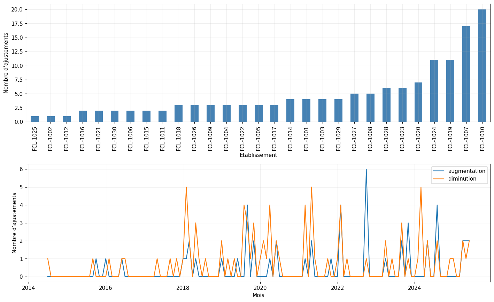

*Fréquences par établissement / période (cellule 36).*

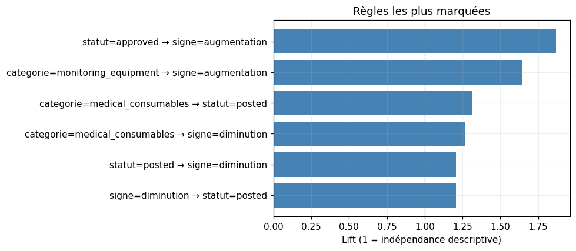

*Règles d'association (cellule 52).*

---

## 8. Fichier `erp_facilities`

### 8.1 Choix techniques

- 30 sites → 29 après nettoyage (1 sans `storage_capabilities`).
- 5 régions ; catégories warehouse / office / lab / clinical, etc.
- Clustering, IF/LOF, graphe, spatial / temporel.

### 8.2 Anomalies

**A.** Environ **6** sites signalés (~21 %), dont des violations de pattern « vieux + cold/security sans premium ».

**B. FCL-1010** : `laboratory_delivery_point`, cold chain + controlled access, opéré par **BP-30021**, signalé parmi les anomalies prioritaires du notebook.

**C. FCL-1011** : `office` / headquarters, opéré par BP-30078, **sans** capacité de stockage déclarée — contexte important pour interpréter ses expéditions massives.

### 8.3 Preuves

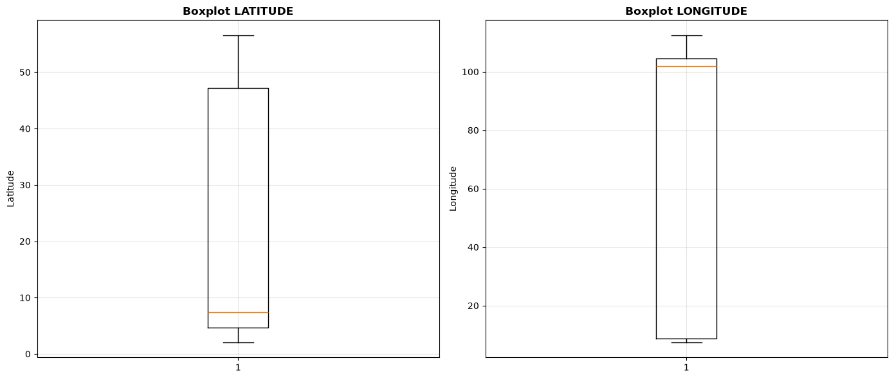

*Outliers numériques facilities (cellule 51).*

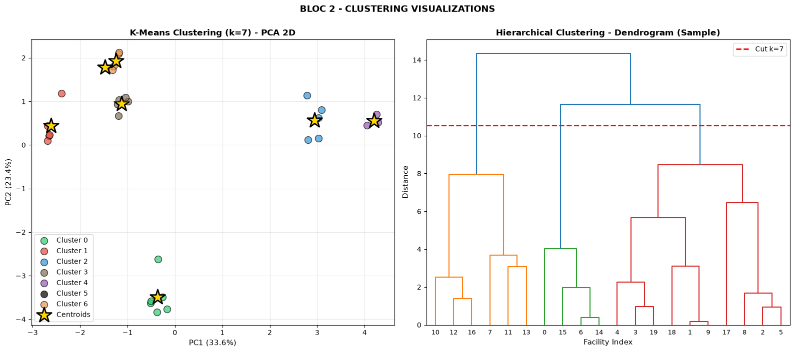

*Projection / anomalies facilities (cellule 92).*

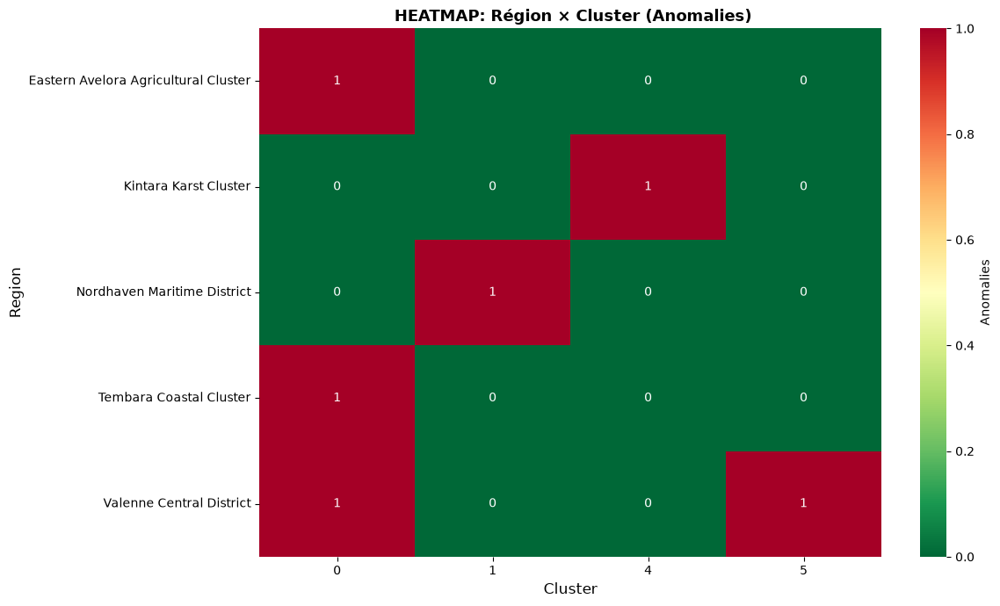

*Analyse spatiale des sites (cellule 125).*

---

## 9. Fichier `erp_business_partners`

### 9.1 Choix techniques

- Référentiel partenaires (rôles, régions, `risk_class`, `partner_status`, onboarding).
- IF/LOF, Apriori, graphe des partenaires anomaliques, spatial / temporel.

### 9.2 Anomalies

**A. BP-30021** : rôle `customer`, région Valenne, statut / risque en **`review`** — opérateur de FCL-1010.

**B. Graphe des partenaires anomaliques** : 22 nœuds, 130 liens, densité ≈ 0,56. Hubs : **BP-30048** (19 liens), BP-30029 (18), BP-30009 (15). Beaucoup d'alertes partagent un même pattern (risk / geo-mismatch).

**C. Temporel / spatial** : anomalies réparties sur de nombreuses années ; concentration **Valenne Republic**. Lecture du notebook : plutôt configuration / onboarding régional défaillant qu'incident unique.

**D.** BP-30048 est calme dans les PO (3 lignes, 0 anomalie) mais hub du graphe ERP : les deux signaux ne se confondent pas.

### 9.3 Preuves

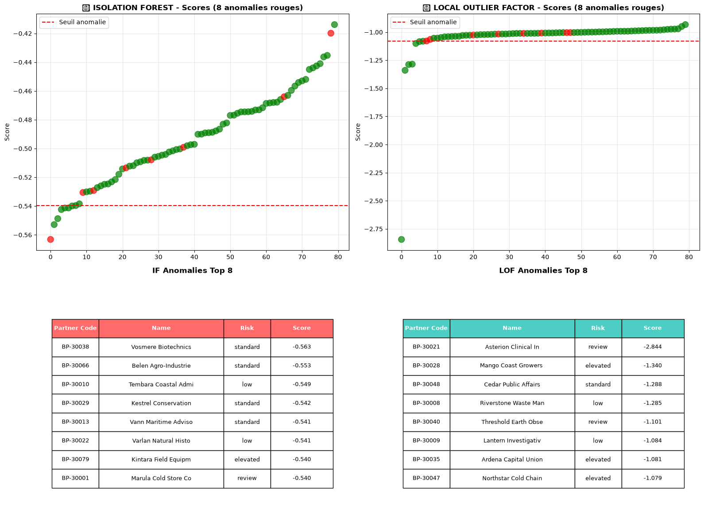

*Visualisation des anomalies partenaires (cellule 99).*

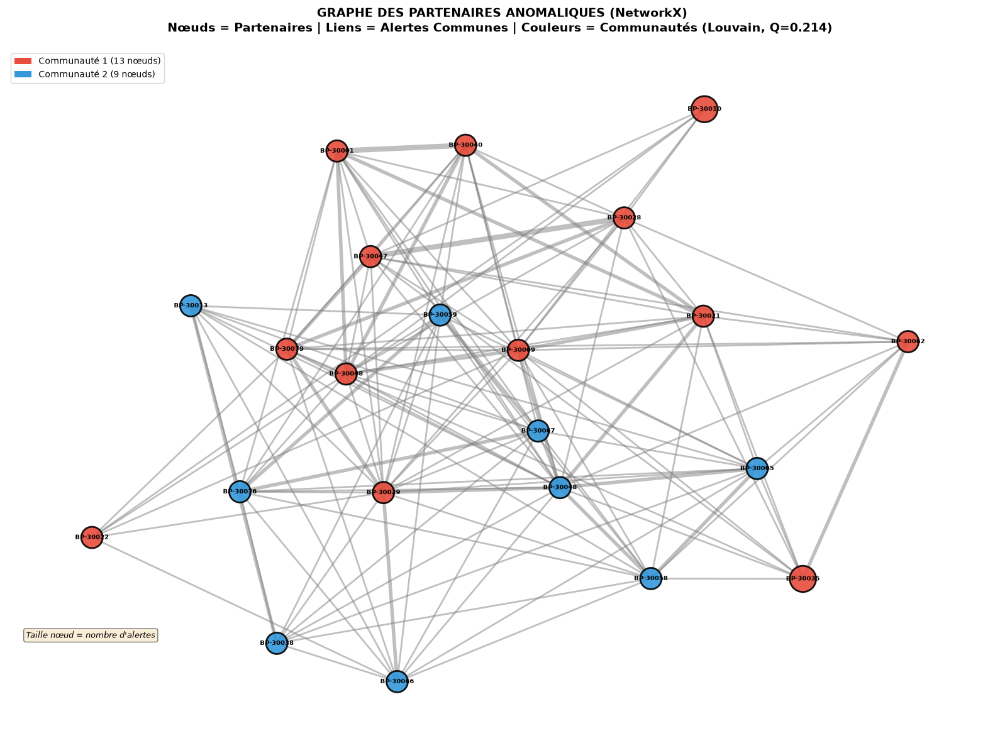

*Graphe des partenaires anomaliques (cellule 135).*

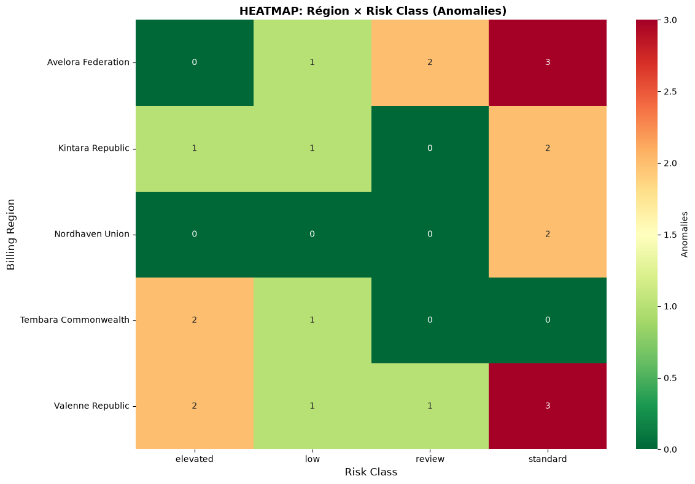

*Analyse spatiale / patterns régionaux (cellule 151).*

---

## 10. Croisement des anomalies

```
FCL-1010 (hub)
   │
   ├── inventory_month_end          fort volume médical persistant
   ├── purchase_order_lines         65 PO ; pas de PO directe avec BP-30021
   ├── shipments                    absorbe 34,5 % du volume intercepté
   │         └── corridor FCL-1011 → FCL-1010 (334 caisses)
   ├── goods_receipts               61 réceptions (3e site)
   ├── inventory_adjustments        20 ajustements ; amplitudes médicales
   ├── erp_facilities               opérateur = BP-30021
   └── erp_business_partners        BP-30021 en review
```

| Fichier | Anomalies / signaux | Lien avec les autres |
|---|---|---|
| `inventory_month_end` | cluster fort volume ~5 % ; 94 stats ; 25 IF/LOF | Hub FCL-1010 / FCL-1020 |
| `purchase_order_lines` | 113 stats ; acteurs FCL-1010 / BP-30021 ; 0 PO 1010×30021 | Amont achat ; lien org. via facilities |
| `shipments` | 23 vol. ; 9 prioritaires ; corridor 1011→1010 | Alimente le stock FCL-1010 |
| `goods_receipts` | 3 pics FCL-1011 ; 65 PO sous-reçues | Boucle commande → réception |
| `inventory_adjustments` | 7 amplitudes medical/case ; 21 refs futures | Piste sur écarts de formule stock |
| `erp_facilities` | FCL-1010 prioritaire ; FCL-1011 = office | Cadre géo / capacités / opérateur |
| `erp_business_partners` | BP-30021 review ; graphe Valenne / BP-30048 | Référentiel risque partenaires |

---

## 11. Conclusion

### Ce que l'enquête logistics montre, en clair

#### Qui est au centre ?
**FCL-1010** (Asterion).  
C'est le site qui revient partout : gros stocks médicaux, beaucoup de commandes, et beaucoup d'expéditions qui arrivent chez lui.

#### Qui gère ce site ?
**BP-30021**.  
Dans l'ERP, c'est lui qui **opère** FCL-1010, et son statut partenaire est **`review`** (à surveiller).

#### Point important
Il n'y a **aucune commande d'achat** directe entre BP-30021 et FCL-1010.  
Donc leur lien n'est pas « il lui vend via une PO », mais plutôt « il gère / est lié au site ».

#### D'où viennent les gros flux ?
Souvent de **FCL-1011** (le siège / bureau).  
Ce site n'est déclaré que comme un **office** (pas un entrepôt), pourtant il envoie beaucoup de matériel vers FCL-1010, surtout des consommables médicaux.

#### Est-ce une preuve de fraude ?
**Non.**  
Les données montrent des **signaux forts** (hub de stock, flux lourds, partenaire en review, corridor inhabituel).  
Mais ça ne prouve pas à lui seul une intention frauduleuse. Il faut encore vérifier cas par cas (expéditions, réceptions, ajustements).

#### En résumé
**FCL-1010 accumule le matériel médical. BP-30021 le gère et est signalé dans l'ERP. FCL-1011 l'alimente de façon atypique. Leur lien ne passe pas par une commande d'achat directe.**

### Points techniques à garder

1. **FCL-1010 est le hub logistics** : stock médical lourd, achats nombreux, destination majeure des expéditions signalées.
2. **BP-30021** est l'opérateur du site et un partenaire en **`review`** ; le lien n'est **pas** une PO directe.
3. **FCL-1011** apparaît comme émetteur atypique (office sans stockage déclaré, pics de réceptions, corridor vers FCL-1010).
4. Les **réceptions** et **ajustements** apportent des indices documentaires (pics, sous-réceptions, références futures), pas des preuves d'intention.
5. Les anomalies ERP partenaires décrivent surtout un **problème systémique Valenne** ; utile pour la qualité du référentiel, distinct du cœur opérationnel FCL-1010.
6. Pour confirmer les liens, relire les 9 expéditions prioritaires, les 21 ajustements à références futures, et les 65 PO sous-reçues — cas par cas, avec les documents.

---

## 12. Index des figures

| Figure | Source | Contenu |
|---|---|---|
| `inventory_month_end_093_1.png` | inventory (93) | Coude / silhouette k=2 |
| `inventory_month_end_104_1.png` | inventory (104) | PCA clusters |
| `inventory_month_end_124_1.png` | inventory (124) | Graphe similarité sites |
| `inventory_month_end_142_1.png` | inventory (142) | Carte facilities |
| `inventory_month_end_149_1.png` | inventory (149) | Série FCL-1010 medical |
| `inventory_month_end_155_1.png` | inventory (155) | Z glissant |
| `purchase_order_lines_086_1.png` | PO (86) | Tendances temporelles |
| `purchase_order_lines_105_1.png` | PO (105) | Choix de k |
| `purchase_order_lines_115_1.png` | PO (115) | PCA clusters achat |
| `shipments_101_1.png` | shipments (101) | Clustering expéditions |
| `shipments_105_1.png` | shipments (105) | PCA shipments |
| `shipments_135_1.png` | shipments (135) | Réseau d'acteurs |
| `shipments_144_1.png` | shipments (144) | Spatio-temporel |
| `goods_receipts_anomalies_028_1.png` | receipts (28) | Volumes / taux |
| `goods_receipts_anomalies_030_1.png` | receipts (30) | Évolution temporelle |
| `goods_receipts_anomalies_032_1.png` | receipts (32) | Qualité trimestrielle |
| `goods_receipts_anomalies_051_1.png` | receipts (51) | Profils établissements |
| `inventory_adjustments_anomalies_026_1.png` | adj (26) | Motifs / directions |
| `inventory_adjustments_anomalies_036_1.png` | adj (36) | Fréquences |
| `inventory_adjustments_anomalies_052_1.png` | adj (52) | Apriori |
| `erp_facilities_051_1.png` | facilities (51) | Outliers |
| `erp_facilities_092_1.png` | facilities (92) | PCA / anomalies |
| `erp_facilities_125_1.png` | facilities (125) | Spatial |
| `erp_business_partners_099_1.png` | partners (99) | Anomalies partenaires |
| `erp_business_partners_135_1.png` | partners (135) | Graphe partenaires |
| `erp_business_partners_151_1.png` | partners (151) | Patterns régionaux |

Le dossier `../figures/` contient aussi les autres schémas extraits des notebooks (67 PNG au total).
