# Rapport public records : anomalies détectées

Neuf fichiers ont été analysés : `officer_filings`, `public_appointments`, `licensed_facilities`, `licensed_professionals`, `institutional_memos` `site_access_case_events.csv` `regulatory_case_events.csv` `registered_entities.csv` et `public_and_investigative_documents`. Chaque anomalie est présentée avec sa méthode, les chiffres issus des notebooks et les figures qui les appuient.

Les notebooks sont `exploration.ipynb` (bloc 1), `clustering.ipynb` (bloc 2) et `anomalies.ipynb` (bloc 3). « anomalies, cellule 16 » désigne la cellule `In [16]` du notebook `anomalies.ipynb`, après *Restart & Run All*. Les figures sont dans `../figures/`, extraites des sorties des notebooks.

---

## Résumé

- **8 personnes sont au sommet depuis 39 à 57 ans** (`public_appointments`, `officer_filings`) : 4 dirigeants politiques et 4 chefs d'entreprise. Ce sont les seuls patients à recevoir les 30 procédures `MRP-42` « restricted_specialist » du dossier Health, toutes réalisées par le même médecin d'Asterion.
- **Deux lignées de noms se succèdent depuis 1840 sans jamais se chevaucher** (`officer_filings`) et aboutissent à deux dirigeants actuels, Elias Voss (Meridian) et Jacob Vale. Les licences des noms anciens sont toujours actives, pour des titulaires qui auraient 125 à 163 ans (`licensed_professionals`).
- **Des incohérences de dates** : 9 mandats finissent avant d'avoir commencé, dont 3 qui masquent un cumul entre Asterion et l'administration de Tembara ; un memo est signé en 2018 par un dirigeant dont le mandat a pris fin en 1991.
- **Le récit textuel tient en 11 documents sur 70** : CHAMELEO, Unwabu, « unités biologiques » manquantes, chauves-souris *Eonycteris spelaea*, transfert « non terrestre ».
- **Les liens avec les autres dossiers sont des coïncidences de noms, de dates et d'identifiants.** Ils ne démontrent pas un programme : ils indiquent où regarder.

---

## 1. Démarche commune

- **Nettoyage** (`public_records.ipynb`) :
  - pipeline commun : dates en formats mixtes converties, doublons sur la clé primaire supprimés (1, dans `officer_filings`), clés et formats d'identifiants vérifiés (tous conformes), espaces multiples corrigés ;
  - `recorded_birth_year` complété à partir des autres nominations de la même personne (9 → 6 manquants) ;
  - aucune valeur extrême supprimée.
- **Variables construites** : les dates sont transformées en durées et en années. Date de référence pour les mandats en cours : 31/12/2025.
- **Détection** :
  - univarié : IQR, z-score (|z| > 3) et z-score modifié (|z| > 3,5) ;
  - multivarié : Isolation Forest, LOF et DBSCAN ;
  - **règles logiques** sur les dates (fin avant début, auteur hors de son mandat, âge d'un titulaire de licence) ;
  - **croisements entre fichiers**.
- **Patterns** : Apriori (`mlxtend`), avec support, confidence, lift et leverage.
- **Clustering** : K-Means (choix de k par coude et silhouette), classification hiérarchique (Ward, ou Hamming pour les variables nominales), DBSCAN ; projections PCA et t-SNE.

---

## 2. Cas central : 8 « élites persistantes » et le traitement `MRP-42`

### 2.1 Ce qui est observé

| Personne | Fonction | Depuis | Années | Patient (Health) | `MRP-42` reçus |
|---|---|---|---|---|---|
| Elira Vaun | présidente du conseil d'État (Avelora) | 1965 | 57 (décès 18/09/2021) | PAT-31099 | 3 (2014–2018) |
| Oskar Nivren | président de Nivren Maritime Logistics | 1973 | 53 | PAT-31074 | 4 (2017–2025) |
| Mirek Talven | gouverneur régional (Tembara) | 1974 | 52 (83 ans) | PAT-31174 | 4 (2015–2021) |
| Celene Varro | directrice générale de Solvane Energy | 1977 | 49 | PAT-31119 | 4 (2018–2024) |
| Leora Kassen | cheffe du gouvernement (Kintara) | 1978 | 48 | PAT-31221 | 5 (2016–2024) |
| Rayan Belen | président de Belen Agro-Industries | 1981 | 45 | PAT-31142 | 3 (2019–2023) |
| Tavian Serat | ministre (Avelora) | 1984 | 42 | PAT-31044 | 4 (2017–2024) |
| Adrienne Solva | directrice d'Ardena Capital Union | 1987 | 39 | PAT-31183 | 3 (2016–2020) |

Sources : anomalies, cellule 15 (ancienneté) ; `health/cleaned/patient_administration` et `clinical_procedures`.

- Le groupe compte **8 personnes pour tout seuil entre 30 et 38 ans** (anomalies, cellule 15). Elias Voss est à la frontière, avec exactement 30 ans.
- Les 30 `MRP-42` « restricted_specialist » (*Targeted metabolic resilience administration*) vont **toutes** à ces 8 patients, et à personne d'autre.
- Elles sont **toutes réalisées par LIC-VLN-MED-1002 (Dr. Naima Orrel, Asterion)** : 16 sur le campus FAC-VLN-101, 14 à la clinique avelorane FAC-AVL-201.
- L'intervalle entre deux procédures est d'environ **742 jours** (2 ans).
- Les 20 autres `MRP-42` (« research_restricted ») concernent 20 patients ordinaires.

### 2.2 Ce qui n'est pas signalé

- En univarié, seule Elira Vaun ressort (durée de 56,7 ans, anomalies, cellule 13). **Un gouverneur de 83 ans en poste depuis 52 ans n'est pas aberrant statistiquement.**
- En multivarié, seuls Vaun et Talven sont signalés par les 3 méthodes (anomalies, cellule 14).
- Le groupe des 8 n'apparaît qu'en **réunissant deux fichiers** (postes publics et dirigeants d'entreprise), puis en **croisant avec Health**.

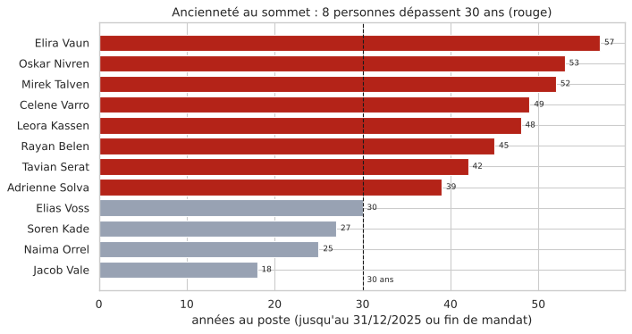

*Années au poste des personnes au sommet (anomalies, cellule 16). En rouge, les 8 personnes qui dépassent 30 ans. Elias Voss est à 30.*

### 2.3 Le document associé

`PUB-510045` (Dr. Lysa Quen, Orison Medical Audit Board, 08/07/2022, restreint) décrit **huit individus** qui reçoivent des interventions de santé récurrentes chez les mêmes cliniciens, souvent juste avant de reprendre des fonctions exigeantes, avec un **âge biologique divergent**. Le document précise qu'il **n'établit ni mécanisme biologique, ni contrepartie, ni objectif politique commun**.

### 2.4 Conclusion sur ce cas

- La concordance est forte : 8 personnes repérées par les dates seules, 8 patients qui sont les seuls à recevoir le même traitement réservé, et un document qui parle de 8 individus.
- **Le rôle du traitement n'est pas démontré.** Un indice va dans ce sens : Vaun ne reçoit plus de `MRP-42` après août 2018, alors que le suivant était attendu vers 2020, et elle décède en septembre 2021.
- *Les croisements avec Health ont été vérifiés directement dans `health/cleaned/` ; ils restent à reporter dans un notebook.*

---

## 3. Fichier `officer_filings`

### 3.1 Choix techniques

- **Variables construites** (exploration, cellule 5) :
  - durée du mandat, délai de déclaration, année de nomination, âge à la nomination ;
  - `birth_year_or_age_band` séparée en année exacte et milieu de tranche (`1970–1979` → 1974,5).
- **Manquants** : les 77 `cessation_date` vides sont exactement les 77 mandats actifs (exploration, cellule 8). Ce sont des mandats en cours : non imputés.
- **Clustering** (clustering, cellules 4 à 8) :
  - variables : année, âge, durée jusqu'en 2025, statut + nationalité (one-hot), standardisées ;
  - exclus : `filing_delay_days` (uniforme, aléatoire) et l'année de naissance (r = 0,98 avec l'année de nomination) ;
  - K-Means k = 5 (silhouette 0,442, contre 0,455 à k = 6 ; k = 5 retenu car plus lisible), comparé à Ward ; DBSCAN avec eps = 1,5 et min_samples = 5.
- **Patterns** (anomalies, cellule 5) : une transaction = une personne ; items = les entreprises où elle a siégé + sa nationalité ; support minimal 0,03.
- **Multivarié** (anomalies, cellule 7) : année, âge, durée ; `contamination = 0,05`.

### 3.2 Anomalies

**A. Nominations du XIXᵉ siècle** (anomalies, cellules 6 et 7) : FLG-000001 Edward Vann **1840**, FLG-000005 J. Varlan **1885**, FLG-000002 Emil Warden **1895**, FLG-000006 Jonah Bell **1924**, FLG-000003 Adrian Vosmere **1952**.
- L'IQR et le z-score modifié signalent les 5 ; le z-score classique seulement 4 (il manque 1952 : effet de masque).
- Les 4 premières sont signalées par **les 3 méthodes multivariées**.
- Chacune est le seul dirigeant connu d'une entreprise dissoute.

**B. Deux lignées sans chevauchement** (anomalies, cellules 9 et 10) :
- **A** : Vann (1840–1888) → Warden (1895–1943) → Vosmere (1952–1991) → **Elias Voss** (FLG-000004, Meridian, depuis 1996). Écarts de 6, 8 et 4 ans.
- **B** : Varlan (1885–1918) → Bell (1924–1963) → Marot (1970–2004) → **Jacob Vale** (FLG-000008, depuis 2008). Écarts de 5, 6 et 3 ans.
- Les initiales se répètent (E. V. → E. W. → A. V. → E. V. ; J. V. → J. B. → J. M. → J. V.). Les intitulés de la lignée A « s'additionnent » : *shipping → medical investor → biotechnology and logistics → BioLogistics*.
- **Limite** : beaucoup de carrières du fichier s'enchaînent sans chevauchement. C'est l'accumulation des indices qui interroge, pas la succession seule.

**C. 9 mandats à durée négative** (anomalies, cellule 8) :
- 6 se terminent la veille de leur début, 3 un an avant (−366 / −367 j). Les 3 cas à un an sont des *Regional advisers* d'Asterion : FLG-000050 Liora Corda, FLG-000077 Jalen Quorin, FLG-000131 Petra Koral.
- **Aucune méthode statistique ne les détecte** : la borne basse de l'IQR est à −2 786 jours.

**D. Dirigeants partagés entre camps opposés** (anomalies, cellule 5) :
- 27 personnes sur 104 ont siégé dans au moins 2 entreprises ; 6 paires d'entreprises partagent exactement 4 dirigeants.
- **Common Ground Climate Forum ⇒ Meridian–Asterion Foundation** : confidence 1, lift 13 (tous les dirigeants passés par la coalition militante sont aussi passés par la fondation du groupe Meridian–Asterion).
- Autres règles : Nivren ⇒ Whitehaven et Helix ⇒ Solvane (lift ≈ 21 avec la nationalité), Meridian ⇒ Valenne Industrial Futures Council.

**E. Clustering** (clustering, cellules 7 et 8) :
- les 5 clusters **sont les 5 nationalités** (62 / 27 / 19 / 17 / 10). K-Means et Ward ne diffèrent que sur 4 lignes ;
- DBSCAN classe 22 points en bruit : les nominations anciennes, des carrières très longues (Belen, Nivren, Solva) et des nationalités peu représentées.

### 3.3 Preuves

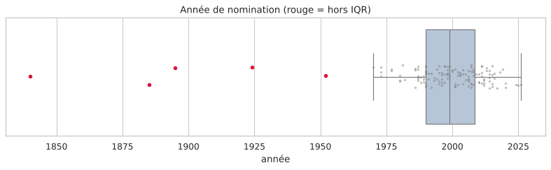

*Année de nomination (anomalies, cellule 6). Les 5 nominations antérieures à 1960, en rouge, sont hors IQR.*

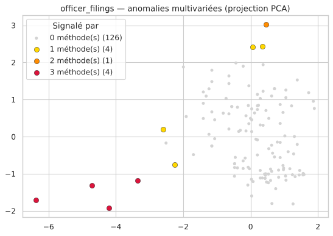

*Projection PCA (anomalies, cellule 7). Les 4 points rouges, signalés par les 3 méthodes, sont les nominations de 1840 à 1924.*

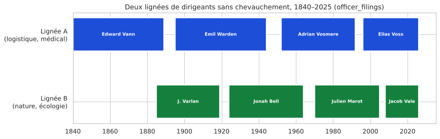

*Frise des deux lignées (anomalies, cellule 10). Les mandats se succèdent sans se chevaucher de 1840 à 2025.*

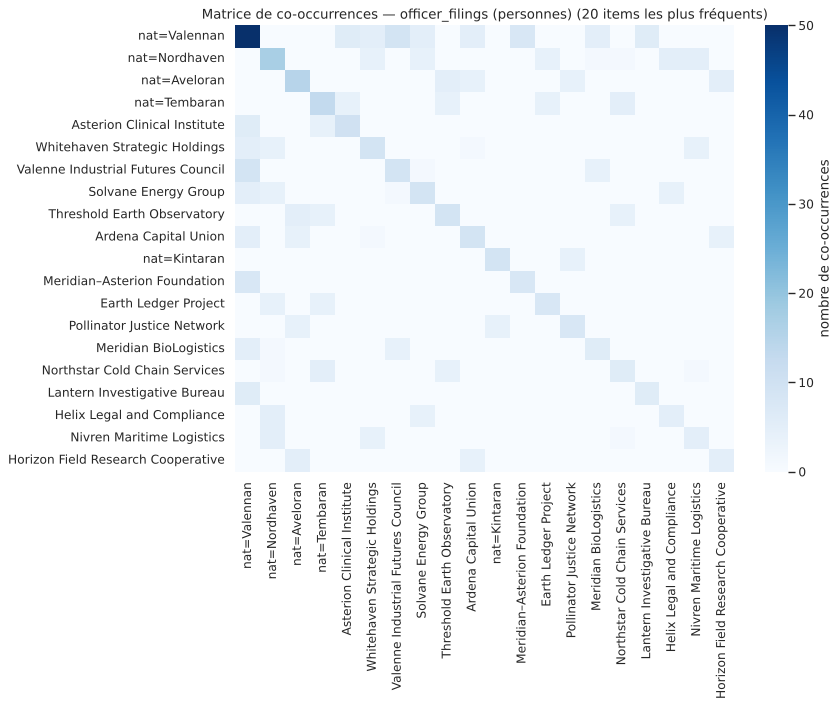

*Matrice de co-occurrences des entreprises et nationalités (anomalies, cellule 5).*

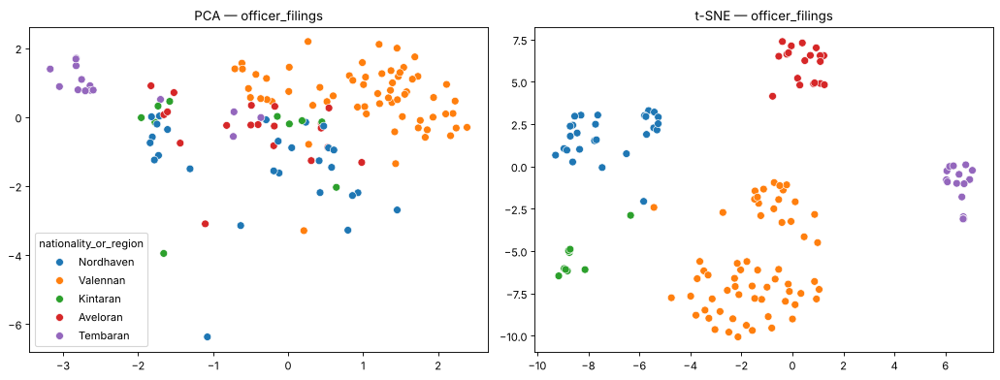

*PCA et t-SNE (clustering, cellule 5). Les îlots correspondent aux nationalités.*

---

## 4. Fichier `public_appointments`

### 4.1 Choix techniques

- **Variables écartées** : `appointment_basis` (constante : « appointed ») et `official_region` (identique à `appointing_jurisdiction`) (exploration, cellule 11).
- **Manquants** : les 34 fins de mandat vides correspondent aux mandats sans motif de départ, donc **en cours**. 6 années de naissance manquantes, imputées par la médiane **uniquement pour le clustering**.
- **Variable construite** : un **niveau hiérarchique** déduit du titre (1 = agent, 2 = cadre, 3 = sommet de l'État) (exploration, cellule 12).
- **Clustering** (clustering, cellules 9 à 13) : one-hot de la juridiction et de l'institution, standardisation, K-Means k = 4 (silhouette 0,28), comparé à Ward (ARI 0,51). DBSCAN jugé inadapté (17 dimensions pour 62 lignes).
- **Multivarié** (anomalies, cellule 14) : année de début, durée, niveau, âge ; `contamination = 0,08`.
- **Élites persistantes** (anomalies, cellule 15) : postes de niveau 3 + dirigeants d'entreprise actifs dont l'intitulé nomme l'entreprise (`officer_filings`), avec un seuil de plus de 30 ans.

### 4.2 Anomalies

**A. 8 élites persistantes** : voir section 2.

**B. Cumul masqué Asterion ↔ Tembara** (anomalies, cellules 17 et 18) : APT-000026 Liora Corda (depuis le 01/01/2013), APT-000038 Jalen Quorin (depuis le 01/01/2012) et APT-000062 Petra Koral (depuis le 01/01/2005) sont **directeurs administratifs régionaux à la Tembara Coastal Administration**, toujours en poste.
- Leur mandat chez Asterion est déclaré terminé **la veille** de leur nomination publique.
- Pourtant, il commence **après** cette nomination (2014, 2013) ou le même jour (2005).

**C. Durée et âge** (anomalies, cellule 13) :
- une seule durée hors IQR : APT-000006 Elira Vaun, 56,7 ans ;
- deux âges de nomination atypiques : Mirek Talven (48 ans) et Elira Vaun (45 ans).

**D. Multivarié** (anomalies, cellule 14) : Vaun et Talven sont signalés par les 3 méthodes ; APT-000058 Jalen Havel, agent d'accréditation depuis **1983** (43 ans), par 2.

**E. Patterns** (anomalies, cellule 12) : règles mécaniques (juridiction ⇔ pays de l'institution). 12 nominations sur 62 se font en Avelora par des Kintarans ou des Valennans, toutes en `role_transition` : régularité de génération, non interprétée.

### 4.3 Preuves

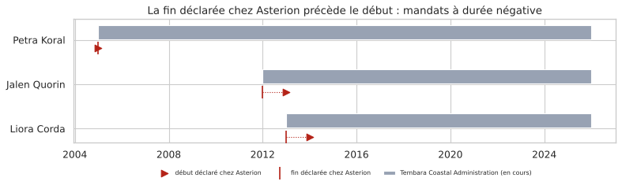

*Périodes déclarées (anomalies, cellule 18). La fin déclarée chez Asterion (trait rouge) précède le début (flèche) et tombe la veille de la fonction publique (barre grise).*

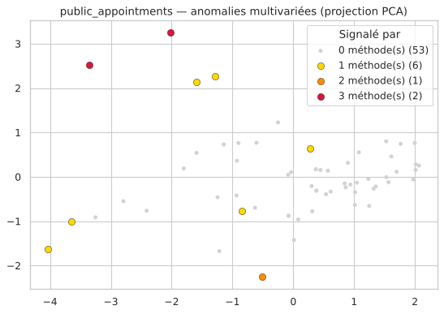

*Projection PCA (anomalies, cellule 14). En rouge, les postes de Vaun et Talven, signalés par les 3 méthodes.*

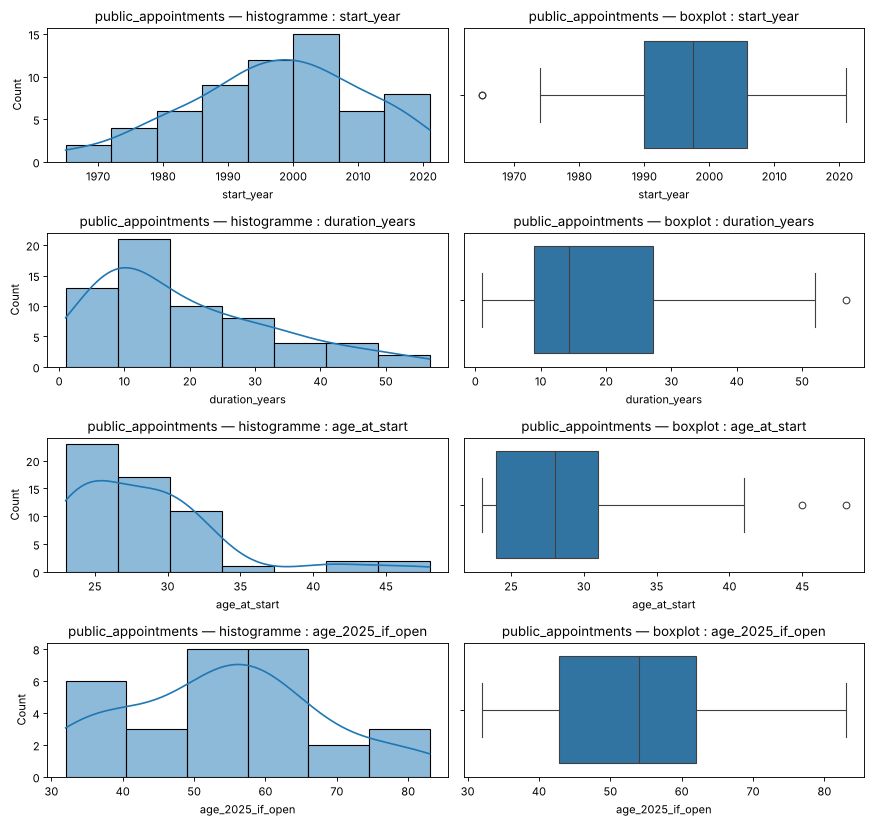

*Distributions (exploration, cellule 14). Queue de durées supérieures à 40 ans ; titulaires encore en poste jusqu'à 83 ans.*

---

## 5. Fichier `licensed_facilities`

### 5.1 Choix techniques

- **3 lignes** : ni statistiques descriptives, ni clustering, ni détection d'anomalies. Description seulement (exploration, cellule 17).
- `license_end` (vide) et `facility_status` (« active ») sont constantes.
- Les coordonnées sont fictives : seules les distances relatives sont interprétées.

### 5.2 Constats

- **Asterion Clinical Institute** exploite son campus en Valenne (FAC-VLN-101) et une **clinique « executive health » en Avelora** (FAC-AVL-201, ouverte en 2008).
- Cette clinique est à environ 22 km du **laboratoire Threshold Earth** (FAC-AVL-301), dans l'*Eastern Avelora Agricultural Cluster*.
- Le laboratoire, **environnemental**, déclare un service de *non-invasive human assessment*.

---

## 6. Fichier `licensed_professionals`

### 6.1 Choix techniques

- **Variables écartées** : `license_status` (constante : « active ») et `license_expiry_date` (vide). `primary_facility_license` vide pour les administratifs et les juristes : recodé en « aucun ».
- **Clustering** (clustering, cellules 15 à 19) : 5 variables nominales en one-hot, **distance de Hamming**, classification hiérarchique `average`, k = 4 (silhouette 0,67) ; K-Means identique (ARI 1) ; DBSCAN avec eps = 0,1.
- **Multivarié non réalisé** : une seule variable numérique (l'année de délivrance).
- **Croisement** (anomalies, cellule 22) : années de naissance reprises de `officer_filings`.

### 6.2 Anomalies

**A. Licences anciennes toujours actives** (anomalies, cellules 21 et 22) :
- LIC-KNT-RES-1007 J. Varlan (**1886**), LIC-VLN-MED-1001 Emil Warden (**1895**, cardiologue sur FAC-VLN-101), LIC-AVL-RES-1008 Jonah Bell (**1924**) ;
- l'IQR signale 5 années (avec Vaun 1965 et Marot 1970), le z-score modifié 3, le z-score classique 2 ;
- croisés avec leurs naissances : **163, 154 et 125 ans en 2025**, alors que leur âge à la délivrance (24 ans) est normal ;
- ces licences sont rattachées à des établissements ouverts entre 2001 et 2012 ;
- **Contrôle** : la licence d'Elira Vaun (LIC-AVL-ADM-1013), décédée en 2021, est aussi restée active. La non-radiation existe donc dans ce registre.

**B. Licence datée du futur** : LIC-VLN-MED-1006 Farah Havel, délivrée le **01/07/2026**.

**C. Clustering** (clustering, cellule 18) : 4 groupes métier.
- administrateurs (21) ;
- laboratoire Threshold Earth (19), dont 2 chercheurs en **recherche clinique** ;
- médecins d'Asterion (8, tous valennans) ;
- juristes (5).

DBSCAN isole les 2 médecins de la clinique avelorane et J. Varlan.

**D. Patterns** (anomalies, cellule 20) : règles définitionnelles (juriste ⇔ conformité ⇔ Nordhaven, lift 10,6).

### 6.3 Preuves

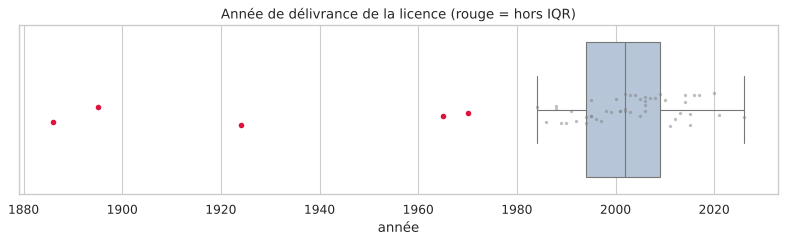

*Année de délivrance (anomalies, cellule 21). En rouge, les 5 licences hors IQR (1886, 1895, 1924, 1965, 1970), toutes encore actives.*

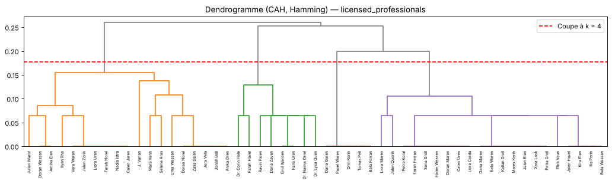

*Dendrogramme en distance de Hamming (clustering, cellule 18), coupé à k = 4.*

Dans Health, la licence d'Emil Warden (LIC-VLN-MED-1001) sert à **147 consultations** (09/2015 → 06/2025) et à 35 procédures. Celle de Farah Havel sert à des consultations dès février 2014, soit 12 ans avant sa date de délivrance.

---

## 7. Fichiers `institutional_memos` et `public_and_investigative_documents`

### 7.1 Choix techniques

- Les deux fichiers sont traités **ensemble** : ils ont la même structure, et la mesure de gabarit se calcule sur tout le corpus. Le texte lui-même relève du bloc 6.
- **Mesures construites** (anomalies, cellule 23) :
  - `n_words` : longueur ;
  - `boilerplate_share` : part des paragraphes présents à l'identique dans au moins 3 documents ;
  - `n_refs` : nombre de références `PO-`, `SHP-`, `ADJ-`, `ACC-`, `REG-`.
- **Clustering non réalisé** : il ne reste que 2 variables nominales par fichier (clustering, cellule 20).
- **Règle logique** (anomalies, cellule 27) : l'auteur appartient-il à l'organisation à la date du document ? Vérifié avec les mandats de `officer_filings` et de `public_appointments`.

### 7.2 Anomalies

**A. 11 documents sans aucun texte gabarit** (anomalies, cellule 25) :
- le z-score modifié les isole. L'**IQR échoue** : sa borne basse est négative, donc inatteignable pour une proportion ;
- le multivarié confirme : les 4 documents signalés par au moins 2 méthodes en font tous partie (anomalies, cellule 26) ;
- les 59 autres documents sont des variations d'un même gabarit, et 27 répètent mot pour mot certains de leurs paragraphes.

| Document | Auteur | Contenu |
|---|---|---|
| `MEM-510100` | Soren Kade, Meridian | Instruction **CHAMELEO** (envoi SHP-2022-00011) |
| `MEM-510101` | Soren Kade, Meridian | Autorité **Unwabu**, escalade vers le bureau exécutif de Meridian |
| `MEM-510062` | Soren Kade, Meridian | « Unités biologiques » manquantes (ADJ-2022-00088) |
| `PUB-510045` | Dr. Lysa Quen | 8 dirigeants, interventions récurrentes (section 2) |
| `PUB-510079` | Mara Venn | *Eonycteris spelaea* pour « consommation », dossier « Kestrel » |
| `PUB-510063` | Mara Venn | Classification « Chamaeleonidian », transfert « non terrestre » |
| `PUB-510044` | Jora Menne | Continuité d'identité de Jacob Vale |
| `PUB-510076`, `PUB-510043`, `PUB-510033` | archives | Alias, Wren Street, « make the conditions ordinary » (1942, 1962) |
| `PUB-510094` | Selene Aras | Stratégies écologiques opposées |

**B. Memo signé par un dirigeant hors mandat** (anomalies, cellule 27) :
- **MEM-510128** (15/05/2018) est signé **Adrian Vosmere** pour Vosmere Biotechnics ;
- or son mandat a pris fin en **1991** et l'entreprise a été **dissoute en 1994**, et le memo porte sur l'envoi SHP-2020-00019, daté de 2020 ;
- au total, 6 documents sont signés hors mandat. Les autres sont plausibles : anciens employés, déclaration tardive.

**C. Leurres** : des paragraphes uniques ajoutés à des documents gabarits donnent une explication banale des termes clés.
- CHAMELEO serait un ancien tableau de bord (MEM-510089) ;
- Unwabu, un bateau ou une référence folklorique (PUB-510127, 1995) ;
- « non-terrestrial », des données satellitaires (PUB-510121) ;
- « external destination », un client hors réseau (MEM-510006, signé hors mandat).

**D. Patterns** (anomalies, cellule 24) : règles définitionnelles (type ⇒ collection) ; règles faibles sur les memos (support 0,067).

### 7.3 Preuves

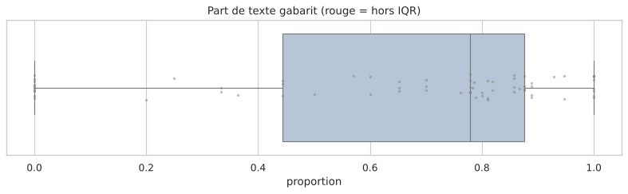

*Part de texte gabarit (anomalies, cellule 25). Les 11 documents à 0 sont à gauche ; aucun n'est hors IQR.*

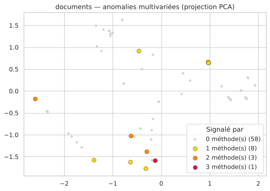

*Projection PCA (anomalies, cellule 26). Les 4 documents signalés par au moins 2 méthodes font partie des 11 documents signal ; MEM-510100 (CHAMELEO) est signalé par les 3.*

---

## 8. Croisement des anomalies

```
8 élites persistantes (public_appointments + officer_filings)
   │
   ├── Health : seuls patients des 30 MRP-42 restricted_specialist, tous faits par LIC-VLN-MED-1002 (Naima Orrel)
   ├── PUB-510045 : « eight individuals », interventions récurrentes, âge biologique divergent
   └── Talven ← cumul masqué Asterion ↔ Tembara Coastal Administration (Corda, Quorin, Koral)

Lignées Vann → Warden → Vosmere → Voss  et  Varlan → Bell → Marot → Vale (officer_filings)
   │
   ├── licensed_professionals : licences de 1886, 1895, 1924 toujours actives
   ├── Health : licence de Warden utilisée pour 147 consultations, 2015–2025
   ├── MEM-510128 : Vosmere signe un memo en 2018
   └── archives : alias, Wren Street, « Chamaeleonidian »

Programme CHAMELEO (memos Meridian)
   │
   ├── Logistics : SHP-2022-00011 déclaré « protective_equipment, ordinary » ; SHP-2023-00035 « legal_service »
   ├── site_access_case_events : dossier Kestrel ACC-2022-0033 (grotte KNT-UJJ) examiné par Quorin, J. Varlan, Pavel Waren
   └── PUB-510079 : chauves-souris Eonycteris spelaea pour « consommation »
```

| Fichier | Anomalies | Lien avec les autres fichiers ou dossiers |
|---|---|---|
| `officer_filings` | 5 nominations de 1840 à 1952 ; 2 lignées ; 9 durées négatives ; ponts entre camps opposés | `licensed_professionals` (mêmes noms), `public_appointments` (cumul), memos (Vosmere) |
| `public_appointments` | 8 élites ; cumul masqué ; Jalen Havel depuis 43 ans | Health (`MRP-42`), PUB-510045 |
| `licensed_facilities` | Laboratoire environnemental qui examine des humains | `licensed_professionals` (chercheurs cliniques), Ecology (zone des grottes) |
| `licensed_professionals` | Licences de 1886 à 1924 actives ; licence datée de 2026 | `officer_filings` (naissances), Health (activité réelle) |
| `institutional_memos` | 3 memos signal ; MEM-510128 hors mandat | Logistics (SHP, ADJ), `officer_filings` (lignée A) |
| `public_and_investigative_documents` | 8 documents signal ; leurres | Health (PUB-510045), Ecology (PUB-510079), lignées (archives) |

---

## 9. Conclusion

1. **Les 8 élites persistantes sont l'indice le plus solide** : elles sont repérées par les dates, isolées dans Health, seules à recevoir le traitement `MRP-42` réservé, et nommées par un document. **Le rôle du traitement n'est pas démontré** : il reste à vérifier leur âge biologique et le lien entre l'arrêt du traitement et le décès d'Elira Vaun.
2. **Les deux lignées et les licences de 125 à 163 ans** suggèrent une continuité d'identité qui aboutit à Elias Voss et Jacob Vale. **L'explication administrative (licences non radiées) existe** dans le registre ; elle n'explique pas l'activité réelle de la licence de Warden entre 2015 et 2025.
3. **Les incohérences de dates** (durées négatives, memo de Vosmere) ne sont visibles que par des règles logiques : aucune méthode statistique ne les détecte.
4. **Les clusters ne révèlent rien de caché** : ils retrouvent la nationalité, la juridiction ou le métier. L'information est dans les points isolés.
5. **Pour confirmer**, il faut :
   - l'âge biologique et les observations cardiaques des 8 élites, de Voss et de Vale (Health) ;
   - le contenu réel des envois CHAMELEO et de l'ajustement ADJ-2022-00088 (Logistics) ;
   - l'évolution des colonies d'*Eonycteris* à la grotte KNT-UJJ et à KNT-KES (Ecology) ;
   - un graphe personnes × organisations (bloc 4).

---

## 10. Index des figures

| Figure | Source (cellule) | Ce qu'elle montre |
|---|---|---|
| `bloc3_16_1.png` | anomalies (16) | Ancienneté au sommet, 8 personnes au-delà de 30 ans |
| `bloc3_06_1.png` | anomalies (6) | Année de nomination, 5 nominations hors IQR |
| `bloc3_07_1.png` | anomalies (7) | Anomalies multivariées de `officer_filings` |
| `bloc3_10_1.png` | anomalies (10) | Frise des deux lignées 1840–2025 |
| `bloc3_05_1.png` | anomalies (5) | Co-occurrences entreprises × nationalités |
| `bloc2_05_1.png` | clustering (5) | PCA et t-SNE de `officer_filings` |
| `bloc3_18_1.png` | anomalies (18) | Cumul masqué Asterion ↔ Tembara |
| `bloc3_14_1.png` | anomalies (14) | Anomalies multivariées de `public_appointments` |
| `bloc1_14_1.png` | exploration (14) | Distributions de `public_appointments` |
| `bloc3_21_1.png` | anomalies (21) | Année de délivrance des licences |
| `bloc2_18_1.png` | clustering (18) | Dendrogramme de `licensed_professionals` |
| `bloc3_25_2.png` | anomalies (25) | Part de texte gabarit des documents |
| `bloc3_26_1.png` | anomalies (26) | Anomalies multivariées des documents |
